# RIVE ROSSE STENCILS

**Language:** [Italiano](README.md) · [Español](README.es.md) · English


Parametric 3D stencils for marking the **RIVE ROSSE** trails: trail signs, technical signs, arrows, difficulty levels, help signs and 190 × 80 mm double plates.

The whole catalog is generated from Python using vector contours, validated as a closed mesh and exported to STL at real scale in millimetres. **The repository contains no G-code**: every user must slice the STL files for their own printer, nozzle and material.

<p align="center">
  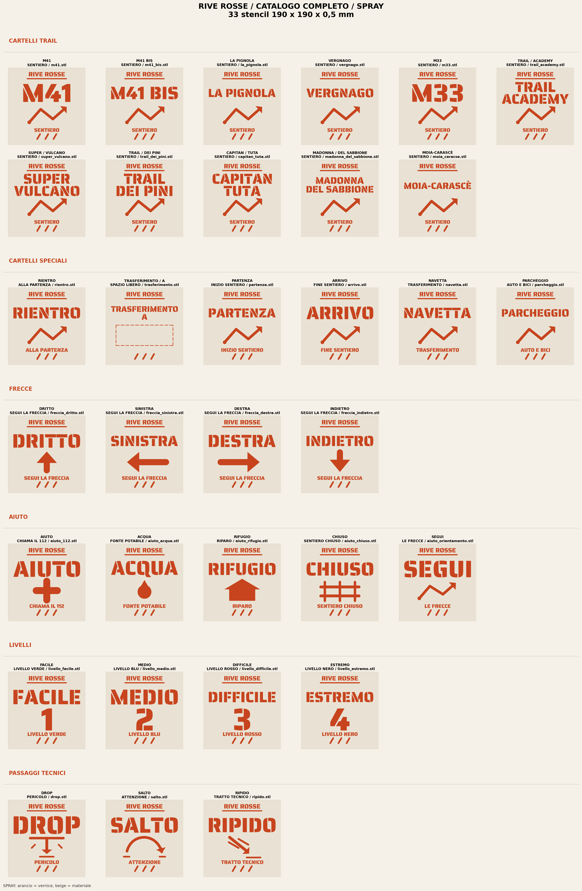
</p>

<p align="center">
  <strong>33 standard designs · 44 narrow plates · 43 double plates · 120 STL</strong>
</p>

---

## Contents

- [What is included](#what-is-included)
- [Specifications](#specifications)
- [Catalog](#catalog)
- [Repository structure](#repository-structure)
- [Requirements and quick start](#requirements-and-quick-start)
- [How it is generated](#how-it-is-generated)
- [Generate the STL files](#generate-the-stl-files)
- [Reusing the engine](#reusing-the-engine)
- [Adding a trail](#adding-a-trail)
- [Customising size and thickness](#customising-size-and-thickness)
- [Printing](#printing)
- [Scripts](#scripts)
- [Validation](#validation)
- [Fonts and credits](#fonts-and-credits)
- [License](#license)
- [Contributing](#contributing)

---

## What is included

| Family | Format | Designs | STL |
|---|---:|---:|---:|
| Trail and special signs | 190 × 190 × 0.5 mm | 17 | 17 |
| Technical signs, arrows, help and levels | 190 × 190 × 0.5 mm | 16 | 16 |
| Narrow signs | 190 × 80 × 0.5 mm | 11 + 1 special arrow | 12 |
| Double plates for narrow signs | 190 × 164 × 0.5 mm | 11 | 11 |
| Compact signs | 190 × 80 × 0.5 mm | 16 | 16 |
| Double plates for compact signs | 190 × 164 × 0.5 mm | 16 | 16 |
| Trails 2 | 190 × 80 × 0.5 mm | 16 | 16 |
| Double plates for Trails 2 | 190 × 164 × 0.5 mm | 16 | 16 |
| **Total** | | | **120** |

Also included:

- **29 PNG** catalog and preview images in `png/`, generated from the same geometry as the STL files.
- Reproducible scripts in `script/`, with a shared engine and automatic validation.
- **Stencil fonts** in `font/`, distributed under the SIL Open Font License 1.1.
- A `Makefile` to generate and verify everything with one command.
- A GitHub Actions workflow that validates all 120 STL files on every push.

> There are no pre-sliced G-code files: G-code depends on the printer, nozzle, material and profile. The STL files are the only interchange format.

---

## Specifications

- **Units:** real millimetres.
- **Thickness:** 0.5 mm.
- **Standard format:** 190 × 190 mm.
- **Narrow format:** 190 × 80 mm.
- **Double plate:** 190 × 164 mm, with a 4 mm gap between the two plates.
- **Margins:** 7–8 mm.
- **Bridges:** built into the design, 2.2–2.4 mm.
- **Mesh:** closed, correctly oriented, no degenerate triangles, a single piece (two in double plates).
- **Text:** vectorized from TTF; no font dependency in the slicer.
- **Previews:** `spray` mode (orange on beige) and `stencil` mode (white on black).

> Each STL is a **solid plate with the stencil cut-outs**, not a relief. The plate sits on the ground and is used as a spray mask.

---

## Catalog

### Complete 190 × 190 mm catalog

| Spray | Stencil |
|---|---|
|  | 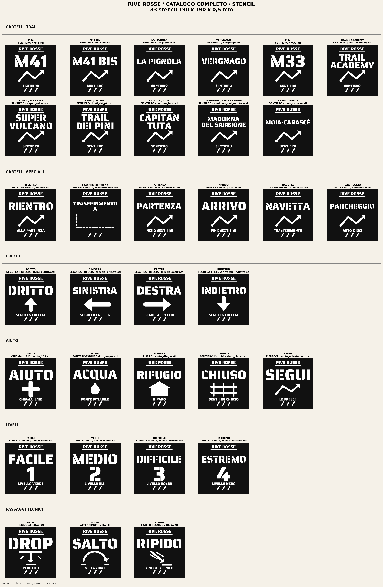 |

### Narrow signs 190 × 80 mm

| Spray | Stencil |
|---|---|
| 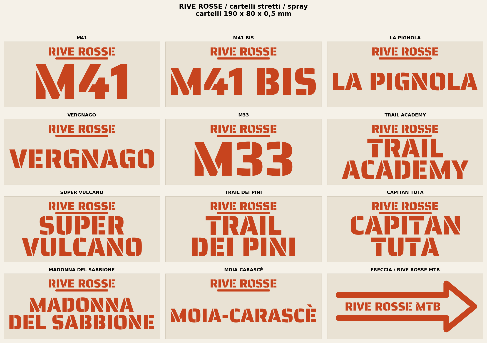 | 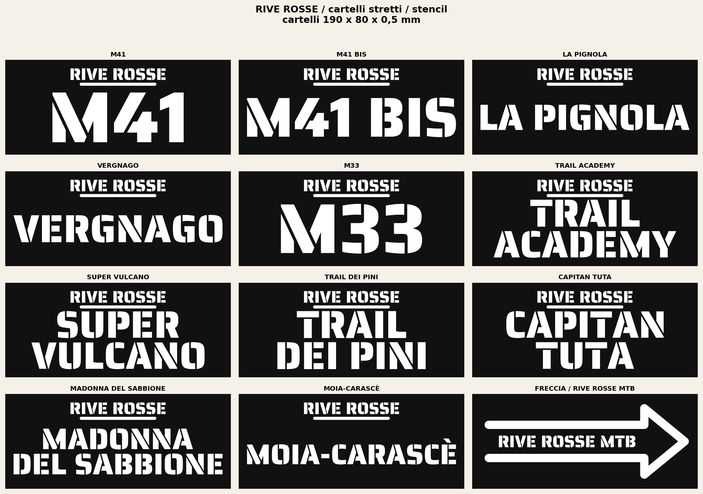 |

### Compact signs 190 × 80 mm

| Spray | Stencil |
|---|---|
| 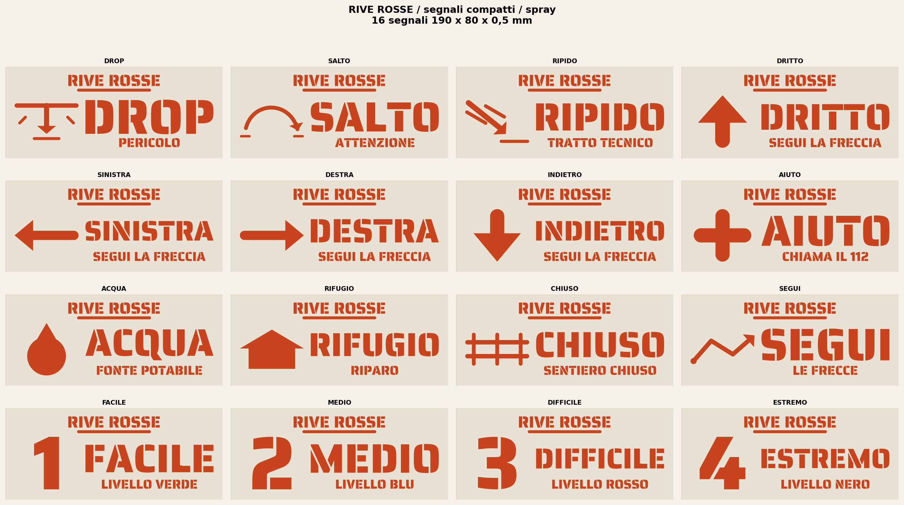 | 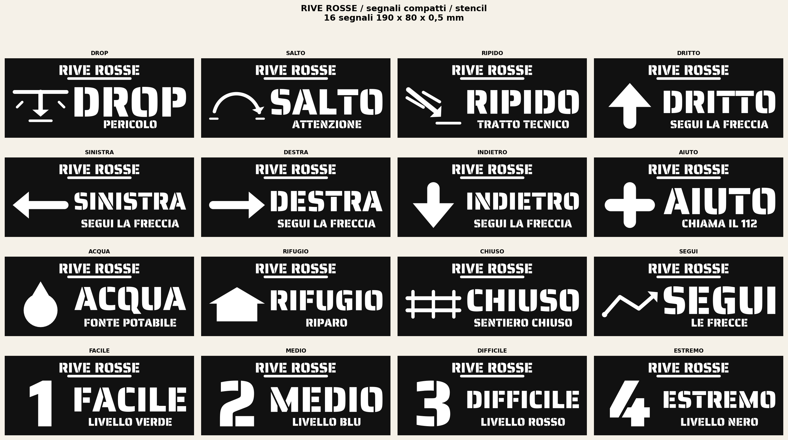 |

### Trails 2

| Spray | Stencil |
|---|---|
| 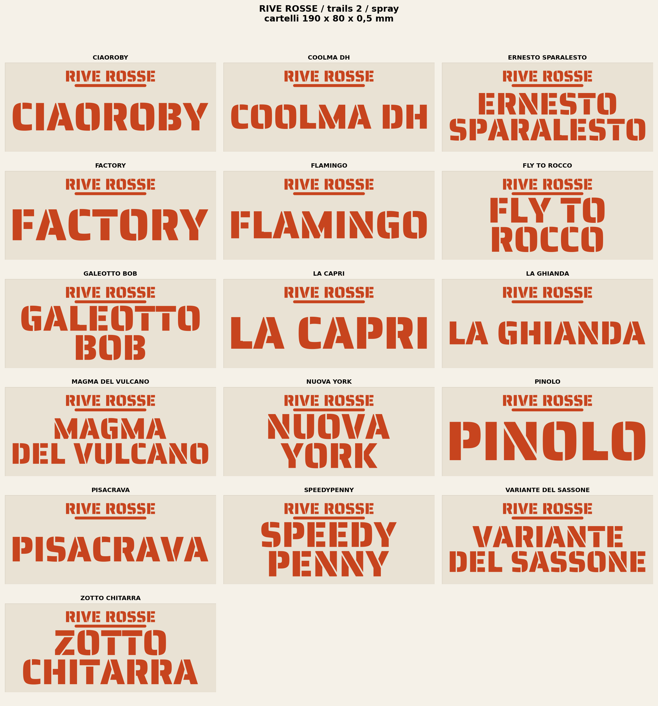 | 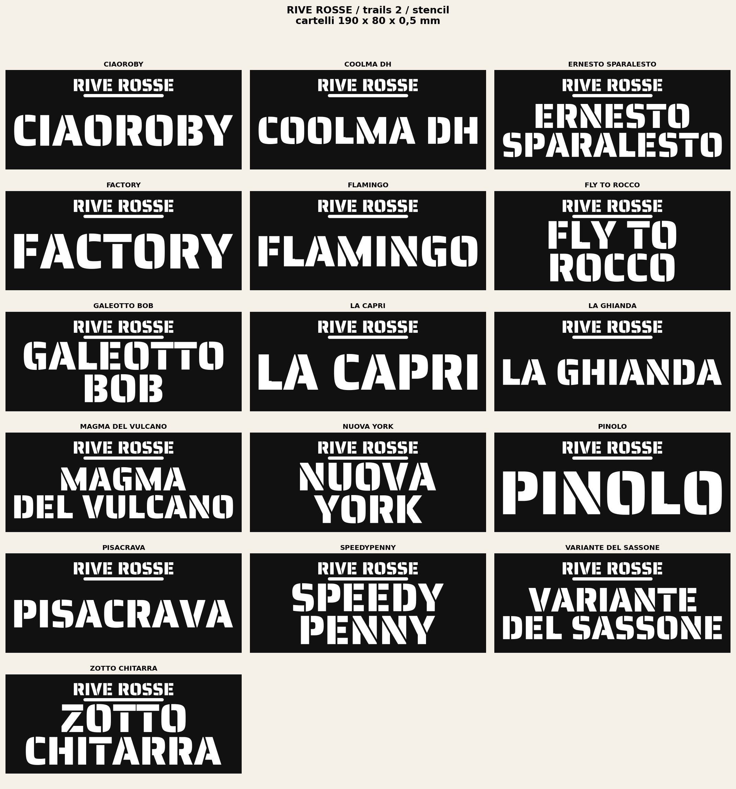 |

### Double plates

| Signs | Signals | Trails 2 |
|---|---|---|
| 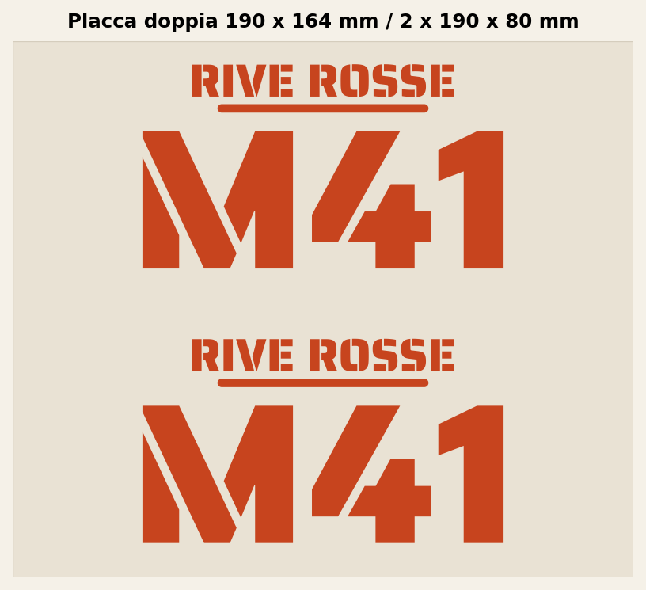 | 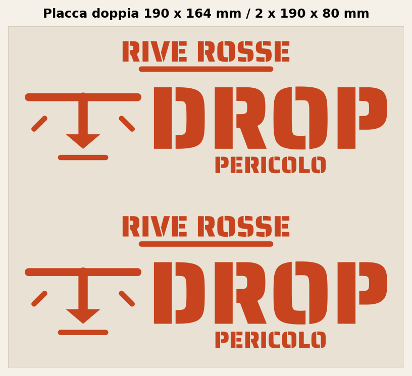 | 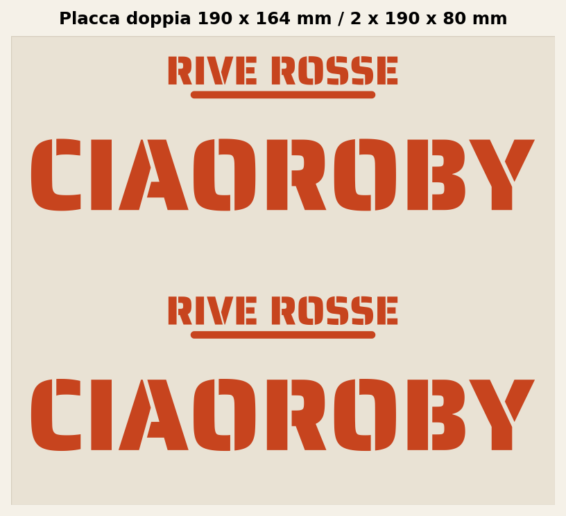 |

---

## Repository structure

```text
RIVE_ROSSE_STENCILS/
├── .github/workflows/        CI validation
├── font/                     Included stencil fonts (OFL)
├── png/                      Catalogs and previews
│   ├── cartelli/
│   ├── cartelli_stretti/
│   ├── segnali/
│   ├── segnali_stretti/
│   └── trails_2/
├── script/                   Generators and validation
│   ├── generare_stencil.py   Reusable shared engine
│   ├── generare_*.py         Per-family generators
│   └── validar_stl.py        Validator for the 120 meshes
├── stl/                      Slicer-ready meshes
│   ├── cartelli/
│   ├── cartelli_stretti/
│   ├── segnali/
│   ├── segnali_stretti/
│   └── trails_2/
├── CONTRIBUTING.md
├── LICENSE                   Code: MIT
├── LICENSE-CONTENT.md        Designs: CC BY-NC-SA 4.0
├── Makefile
├── README.md                 Italian
├── README.es.md              Spanish
├── README.en.md              English
└── requirements.txt
```

---

## Requirements and quick start

- Python **3.10 or newer** (tested with 3.9–3.12).
- `pip` and, optionally, `make`.
- macOS, Linux or Windows.

```bash
git clone https://github.com/mattiaa95/RIVE-ROSSE-STENCILS.git
cd RIVE-ROSSE-STENCILS

make install     # creates .venv and installs requirements.txt
make all         # regenerates every STL and PNG
make check       # validates the 120 STL files
```

Without `make`:

```bash
python3 -m venv .venv
source .venv/bin/activate          # Windows: .venv\Scripts\activate
python3 -m pip install -r requirements.txt
```

Main dependencies: `fonttools`, `shapely`, `trimesh`, `manifold3d`, `scipy`, `numpy` and `matplotlib`. `scipy` is not optional: `trimesh` uses it to split and validate the pieces.

---

## How it is generated

Every script follows the same pipeline:

1. **Font and contours.** `generare_stencil.py` loads the TTF and converts each glyph into polygons by flattening curves (`_texto_a_poligono`). It uses the even-odd rule and reconnects the foot of the `L`, which Saira Stencil One ships separated.
2. **Composition.** Each design defines its lines; the block is scaled and centred while respecting fixed margins.
3. **Plate.** The text is subtracted from the rectangle. Counters and inner islands are connected to the plate with bridges (`_conectar_islas`, `_reforzar_puentes`).
4. **2D validation.** Margins, centring, open area, line spacing and the single-piece condition are checked.
5. **Extrusion.** The plate is extruded to 0.5 mm with `manifold3d.CrossSection` and `Manifold.extrude`. Then `simplify(1e-9)` removes zero-area triangles on straight edges.
6. **3D validation.** The mesh must be watertight, have consistent normals, no degenerate triangles, the expected volume and a single piece (two in double plates).
7. **Export.** The STL is written, reloaded and validated again.
8. **Previews.** PNG files are drawn from the same polygons, so the preview and the printed part share the same contours.

The generators write directly to `stl/` and `png/` and create any missing folders.

---

## Generate the STL files

### Standard 190 × 190 catalog

```bash
make standard

# equivalent
python3 script/generare_cartelli.py
python3 script/generare_segnali.py
python3 script/generare_segnali_aiuto.py
```

### Narrow 190 × 80 catalog

```bash
make narrow

# equivalent
python3 script/generare_cartelli_stretti.py
python3 script/generare_segnali_stretti.py
python3 script/generare_trails_2.py
```

### PNG catalogs

```bash
make catalogs
# or: python3 script/generare_catalogo.py
```

### Check

```bash
make check
# or: python3 script/validar_stl.py --verbose
```

---

## Reusing the engine

`script/generare_stencil.py` is the shared module and can be imported by other scripts or projects:

| Function | Purpose |
|---|---|
| `_resolver_fuente`, `_abrir_fuente` | Find and open a real stencil font (`ttf`, `otf`, `ttc`). |
| `_texto_a_poligono` | Convert one line of text into a Shapely polygon. |
| `_disponer_texto` | Scale and centre a two-line block. |
| `_conectar_islas`, `_reforzar_puentes` | Add material bridges to islands and counters. |
| `_crear_malla` | Extrude a polygon into a closed mesh. |
| `_validar_2d`, `_validar_malla`, `_recargar_y_validar_stl` | Validate geometry and the exported STL. |

These are internal functions (leading `_`): they can be reused, but the API may change between versions. For a new design it is safer to copy the structure of an existing generator.

Also reusable:

- `script/validar_stl.py`: validates any catalog with this repository's folder layout.
- `Makefile` and `.github/workflows/validate.yml`: generation and CI template.
- `font/`: OFL fonts ready for vectorization.

---

## Adding a trail

1. Open the generator for the family. For narrow 190 × 80 signs, for example `script/generare_trails_2.py`.
2. Add an entry to the list:

```python
car.Cartel("TRAIL NAME", ["TRAIL", "NAME"], "trail_name.stl")
```

3. Use uppercase text and lowercase ASCII file names. Every character must exist in the font; if one is missing, the script stops with a clear error.
4. Regenerate and validate:

```bash
python3 script/generare_trails_2.py
make check
```

5. Commit the script together with the regenerated STL and PNG files.

---

## Customising size and thickness

The global parameters are at the top of each generator (`ANCHO`, `ALTO`, `GROSOR`, `MARGEN`, `ANCHO_PUENTE`) and are synchronised with the base module (`base.ANCHO`, etc.).

- For a larger or thicker plate, change those values and run the generator again.
- **Do not change only thickness or format without reviewing the bridges**: the 2.2–2.4 mm bridges are tuned for 0.5 mm and for the current contours. If the text becomes thinner or the plate larger, increase `ANCHO_PUENTE` and validate.
- Do not scale the STL in the slicer if you want to keep the real size.
- If you change the font, use an authentic stencil font; the engine rejects conventional fonts to avoid silently wrong results.

---

## Printing

Reference settings for 0.5 mm plates:

| Setting | Value |
|---|---|
| Scale | 100% |
| Layer height | 0.20 mm |
| Solid top/bottom layers | 3 |
| Perimeters | 2–3 |
| Infill | 100% or solid equivalent |
| Supports | No |
| Material | PLA / PETG |
| Orientation | Flat, with the stencil face up |

Recommendations:

- Check the first layer: the plate is thin and needs good adhesion.
- Let the plate cool before removing it from the bed.
- Make sure the internal bridges remain open after slicing.
- For ground painting, use low-pressure spray and remove the mask carefully.
- If you change printer, nozzle or material, **slice the STL files again**: there is no universal G-code.

---

## Scripts

| Script | Purpose |
|---|---|
| `generare_stencil.py` | Shared engine: fonts, polygons, boolean operations, bridges, extrusion and validation. |
| `generare_segnali.py` | 190 × 190 technical signs: DROP, SALTO, RIPIDO. |
| `generare_segnali_aiuto.py` | Arrows, help signs, levels and orientation signs. |
| `generare_cartelli.py` | Trail signs and special signs, 190 × 190. |
| `generare_catalogo.py` | Complete PNG catalog and sign catalog. |
| `generare_cartelli_stretti.py` | Narrow signs, double plates and MTB arrow. |
| `generare_segnali_stretti.py` | Compact 190 × 80 signs and their double plates. |
| `generare_trails_2.py` | The 16 Trails 2 signs. |
| `validar_stl.py` | Validates the 120 STL files: dimensions, watertightness, pieces and triangles. |

---

## Validation

Every STL is checked automatically before export and again after being reloaded:

- exact dimensions in millimetres;
- closed, correctly oriented mesh with positive volume;
- a single piece (two in double plates);
- no degenerate triangles;
- open area consistent with the design;
- bridges and spacing between elements;
- extrusion between z = 0 and z = 0.5 mm.

```bash
make check
```

The same check runs in GitHub Actions (`.github/workflows/validate.yml`) on every push and pull request.

---

## Fonts and credits

- **Saira Stencil One** — main font, in `font/SairaStencilOne-Regular.ttf`.
- **Allerta Stencil** — alternative, in `font/AllertaStencil-Regular.ttf`.
- Font license texts in `font/SairaStencilOne-OFL.txt` and `font/AllertaStencil-OFL.txt`.
- Geometry and generation: Python + `fonttools`, `shapely`, `trimesh`, `manifold3d`, `scipy`, `numpy` and `matplotlib`.
- Trail designs and names: **RIVE ROSSE**.

The fonts are distributed under the **SIL Open Font License 1.1**. They are not covered by the design license: check the original license of each family before redistributing them separately.

---

## License

This repository uses two licenses:

- **Code** (`script/`, `Makefile`, workflows and technical documentation): **MIT**. See [LICENSE](LICENSE).
- **Designs, STL files, PNG files and trail names**: **CC BY-NC-SA 4.0** (attribution, non-commercial, share-alike). See [LICENSE-CONTENT.md](LICENSE-CONTENT.md).
- **Fonts**: **SIL Open Font License 1.1**, outside these two licenses.

The **RIVE ROSSE** name and trademarks belong to their respective owners. This license grants no trademark rights and does not imply endorsement. Commercial use of the designs requires explicit permission.

---

## Contributing

See [CONTRIBUTING.md](CONTRIBUTING.md). In short: `make install`, `make all`, `make check`, and always include the regenerated STL and PNG files in the commit.
