# RIVE ROSSE STENCILS

**Idioma:** [Italiano](README.md) · Español · [English](README.en.md)


Stencils 3D paramétricos para señalizar los trails de **RIVE ROSSE**: carteles de trail, señales técnicas, flechas, niveles, ayuda y placas dobles de 190 × 80 mm.

Todo el catálogo se genera desde Python a partir de contornos vectoriales, se valida como malla cerrada y se exporta en STL a escala real en milímetros. **El repositorio no contiene G-code**: cada usuario debe laminar los STL con su propia impresora, boquilla y material.

<p align="center">
  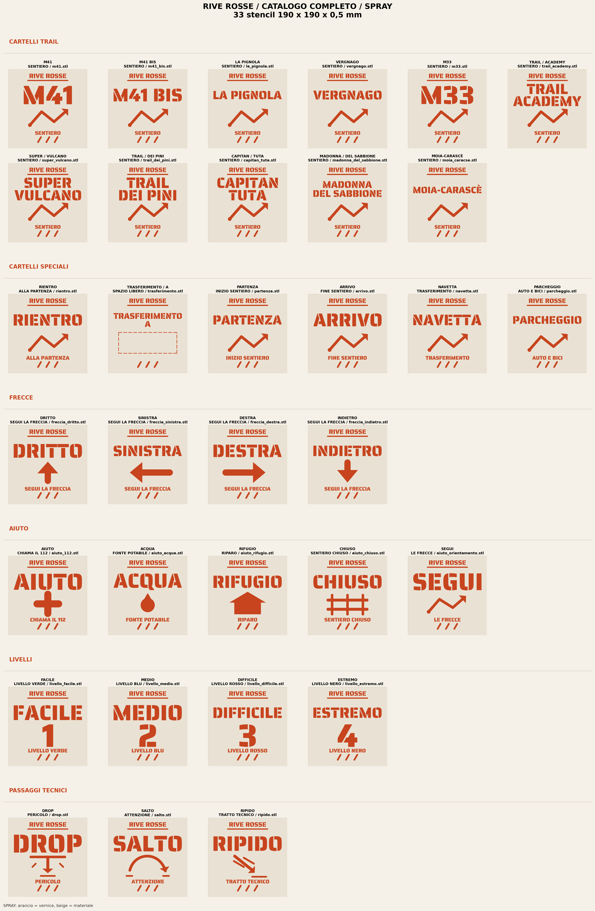
</p>

<p align="center">
  <strong>33 diseños estándar · 44 placas estrechas · 43 placas dobles · 120 STL</strong>
</p>

---

## Contenido

- [Qué incluye](#qué-incluye)
- [Especificaciones](#especificaciones)
- [Catálogo](#catálogo)
- [Estructura del repositorio](#estructura-del-repositorio)
- [Requisitos e inicio rápido](#requisitos-e-inicio-rápido)
- [Cómo se genera](#cómo-se-genera)
- [Generar los STL](#generar-los-stl)
- [Reutilizar el motor](#reutilizar-el-motor)
- [Añadir un trail](#añadir-un-trail)
- [Personalizar formato y grosor](#personalizar-formato-y-grosor)
- [Impresión](#impresión)
- [Scripts](#scripts)
- [Validación](#validación)
- [Fuentes y créditos](#fuentes-y-créditos)
- [Licencia](#licencia)
- [Contribuir](#contribuir)

---

## Qué incluye

| Familia | Formato | Diseños | STL |
|---|---:|---:|---:|
| Carteles de trail y especiales | 190 × 190 × 0,5 mm | 17 | 17 |
| Señales técnicas, flechas, ayuda y niveles | 190 × 190 × 0,5 mm | 16 | 16 |
| Carteles estrechos | 190 × 80 × 0,5 mm | 11 + 1 flecha especial | 12 |
| Placas dobles de carteles estrechos | 190 × 164 × 0,5 mm | 11 | 11 |
| Señales compactas | 190 × 80 × 0,5 mm | 16 | 16 |
| Placas dobles de señales compactas | 190 × 164 × 0,5 mm | 16 | 16 |
| Trails 2 | 190 × 80 × 0,5 mm | 16 | 16 |
| Placas dobles de Trails 2 | 190 × 164 × 0,5 mm | 16 | 16 |
| **Total** | | | **120** |

Además:

- **29 PNG** de catálogo y previsualización en `png/`, generados desde la misma geometría que los STL.
- Scripts reproducibles en `script/`, con un motor común y validación automática.
- **Fuentes stencil incluidas** en `font/`, distribuidas con SIL Open Font License 1.1.
- `Makefile` para generar y verificar todo con un solo comando.
- CI de GitHub Actions que valida los 120 STL en cada push.

> No hay G-code prelaminado: un G-code depende de la impresora, la boquilla, el material y el perfil. Los STL son el único formato de intercambio.

---

## Especificaciones

- **Unidades:** milímetros reales.
- **Grosor:** 0,5 mm.
- **Formato estándar:** 190 × 190 mm.
- **Formato estrecho:** 190 × 80 mm.
- **Placa doble:** 190 × 164 mm, con 4 mm de separación entre las dos placas.
- **Márgenes:** 7–8 mm.
- **Puentes:** integrados en el diseño, 2,2–2,4 mm.
- **Malla:** cerrada, orientada, sin triángulos degenerados, una sola pieza (dos en las placas dobles).
- **Texto:** vectorizado desde TTF; no depende de la fuente en el laminador.
- **Previsualizaciones:** modo `spray` (naranja sobre beige) y modo `stencil` (blanco sobre negro).

> Cada STL es una **placa sólida con los huecos del stencil**, no un relieve. La placa se apoya en el suelo y se usa como plantilla para spray.

---

## Catálogo

### Catálogo completo 190 × 190 mm

| Spray | Stencil |
|---|---|
|  | 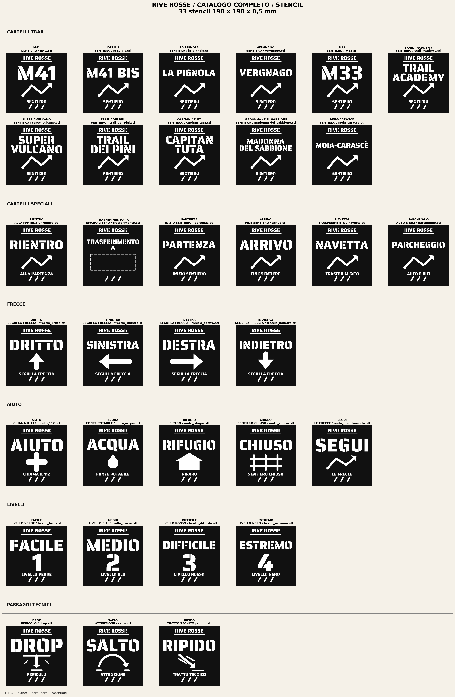 |

### Carteles estrechos 190 × 80 mm

| Spray | Stencil |
|---|---|
| 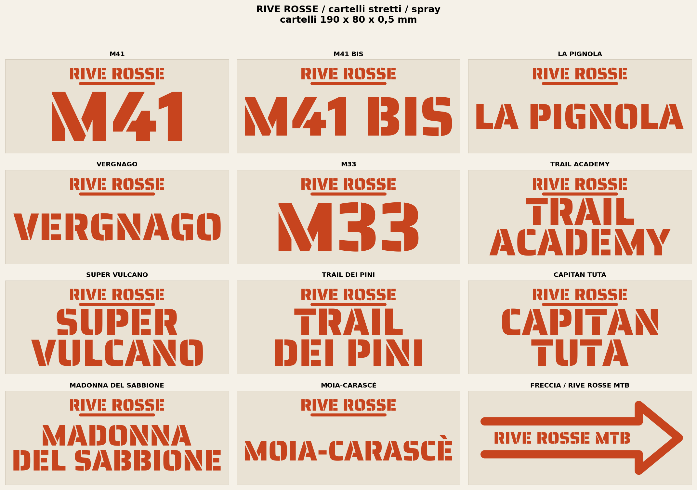 | 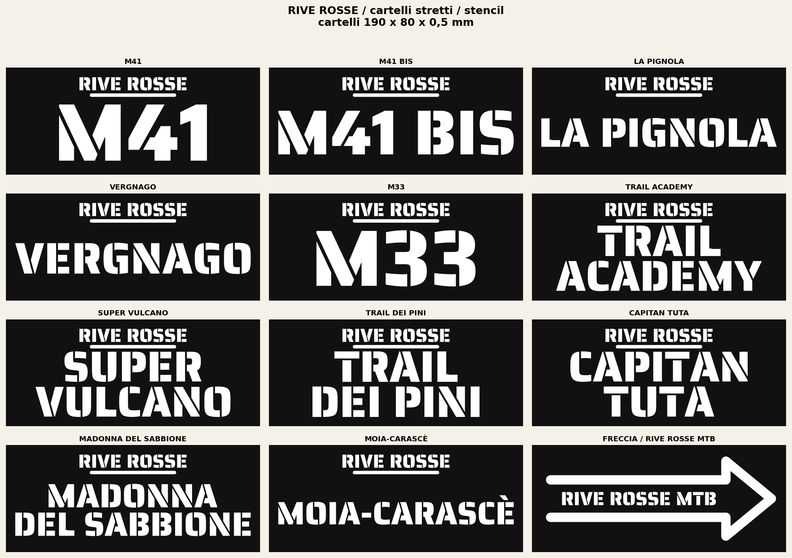 |

### Señales compactas 190 × 80 mm

| Spray | Stencil |
|---|---|
| 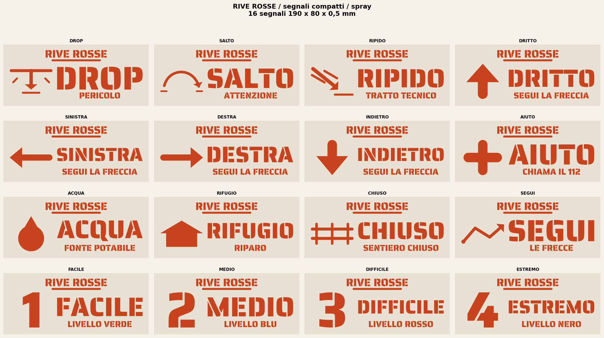 | 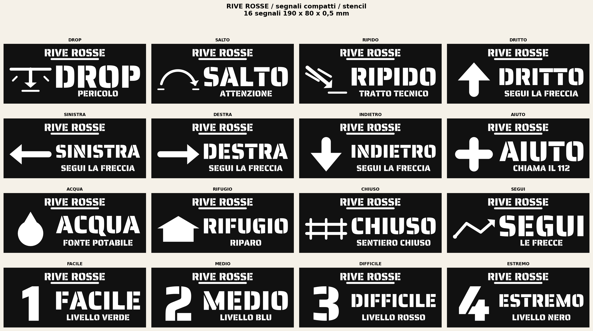 |

### Trails 2

| Spray | Stencil |
|---|---|
| 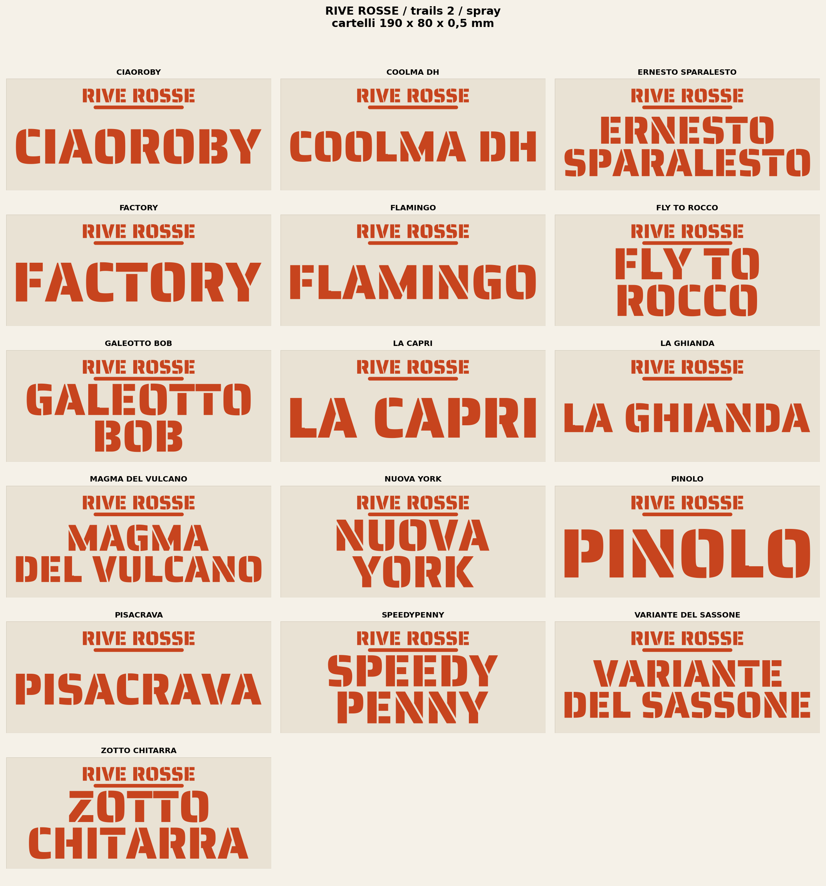 | 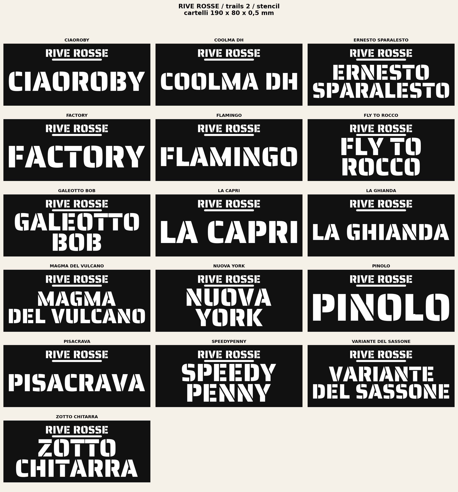 |

### Placas dobles

| Carteles | Señales | Trails 2 |
|---|---|---|
| 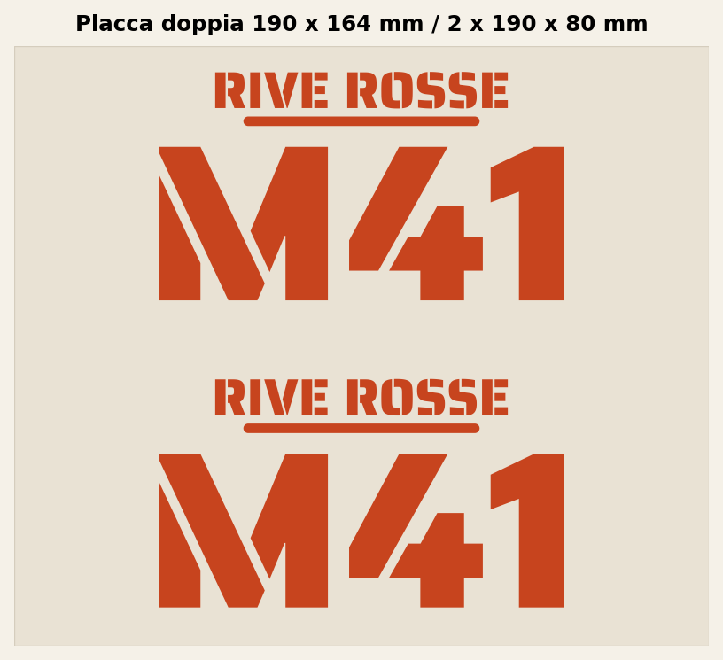 | 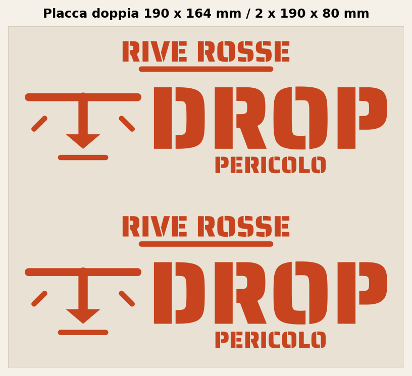 | 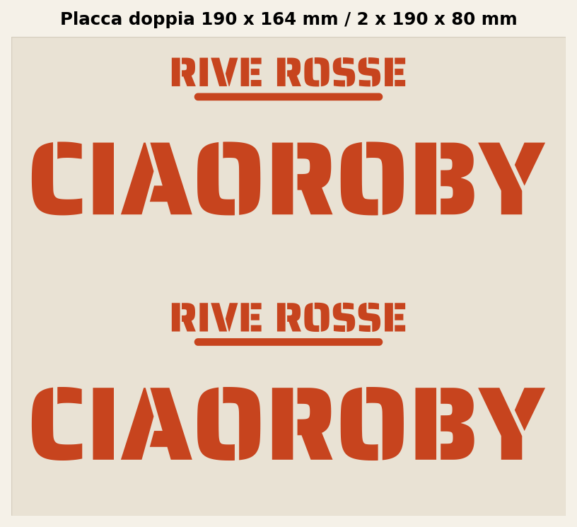 |

---

## Estructura del repositorio

```text
RIVE_ROSSE_STENCILS/
├── .github/workflows/        CI de validación
├── font/                     Fuentes stencil incluidas (OFL)
├── png/                      Catálogos y previsualizaciones
│   ├── cartelli/
│   ├── cartelli_stretti/
│   ├── segnali/
│   ├── segnali_stretti/
│   └── trails_2/
├── script/                   Generadores y validación
│   ├── generare_stencil.py   Motor común reutilizable
│   ├── generare_*.py         Generadores por familia
│   └── validar_stl.py        Validador de las 120 mallas
├── stl/                      Mallas listas para el laminador
│   ├── cartelli/
│   ├── cartelli_stretti/
│   ├── segnali/
│   ├── segnali_stretti/
│   └── trails_2/
├── CONTRIBUTING.md
├── LICENSE                   Código: MIT
├── LICENSE-CONTENT.md        Diseños: CC BY-NC-SA 4.0
├── Makefile
├── README.md                 Italiano
├── README.es.md              Español
├── README.en.md              English
└── requirements.txt
```

---

## Requisitos e inicio rápido

- Python **3.10 o superior** (probado con 3.9–3.12).
- `pip` y, opcionalmente, `make`.
- macOS, Linux o Windows.

```bash
git clone https://github.com/mattiaa95/RIVE-ROSSE-STENCILS.git
cd RIVE-ROSSE-STENCILS

make install     # crea .venv e instala requirements.txt
make all         # regenera todos los STL y PNG
make check       # valida los 120 STL
```

Sin `make`:

```bash
python3 -m venv .venv
source .venv/bin/activate          # Windows: .venv\Scripts\activate
python3 -m pip install -r requirements.txt
```

Dependencias principales: `fonttools`, `shapely`, `trimesh`, `manifold3d`, `scipy`, `numpy` y `matplotlib`. `scipy` no es opcional: `trimesh` lo usa para separar y validar las piezas.

---

## Cómo se genera

Todos los scripts siguen el mismo flujo:

1. **Fuente y contornos.** `generare_stencil.py` carga el TTF y convierte cada glifo en polígonos aplanando las curvas (`_texto_a_poligono`). Usa la regla par-impar y reconecta el pie de la `L`, que Saira Stencil One trae separado.
2. **Composición.** Cada diseño define sus líneas; el bloque se escala y centra respetando márgenes fijos.
3. **Placa.** El texto se resta del rectángulo. Los contrapunzones y las islas interiores se conectan a la placa con puentes (`_conectar_islas`, `_reforzar_puentes`).
4. **Validación 2D.** Se comprueban márgenes, centrado, área abierta, separación de líneas y que quede una sola pieza.
5. **Extrusión.** La placa se extruye a 0,5 mm con `manifold3d.CrossSection` y `Manifold.extrude`. Después se aplica `simplify(1e-9)` para eliminar triángulos de área cero en bordes rectos.
6. **Validación 3D.** Se comprueba que la malla sea estanca, con normales coherentes, sin triángulos degenerados, con el volumen esperado y una sola pieza (dos en placas dobles).
7. **Exportación.** Se escribe el STL, se vuelve a cargar y se valida otra vez.
8. **Previsualizaciones.** Los PNG se dibujan desde los mismos polígonos, así que la vista previa y la pieza impresa comparten contornos.

Los generadores escriben directamente en `stl/` y `png/` y crean las carpetas que falten.

---

## Generar los STL

### Catálogo estándar 190 × 190

```bash
make standard

# equivalente
python3 script/generare_cartelli.py
python3 script/generare_segnali.py
python3 script/generare_segnali_aiuto.py
```

### Catálogo estrecho 190 × 80

```bash
make narrow

# equivalente
python3 script/generare_cartelli_stretti.py
python3 script/generare_segnali_stretti.py
python3 script/generare_trails_2.py
```

### Catálogos PNG

```bash
make catalogs
# o: python3 script/generare_catalogo.py
```

### Comprobación

```bash
make check
# o: python3 script/validar_stl.py --verbose
```

---

## Reutilizar el motor

`script/generare_stencil.py` es el módulo común y puede importarse desde otros scripts o proyectos:

| Función | Uso |
|---|---|
| `_resolver_fuente`, `_abrir_fuente` | Localizar y abrir una fuente stencil real (`ttf`, `otf`, `ttc`). |
| `_texto_a_poligono` | Convertir una línea de texto en un polígono de Shapely. |
| `_disponer_texto` | Escalar y centrar un bloque de dos líneas. |
| `_conectar_islas`, `_reforzar_puentes` | Añadir puentes de material a islas y contrapunzones. |
| `_crear_malla` | Extruir un polígono a una malla cerrada. |
| `_validar_2d`, `_validar_malla`, `_recargar_y_validar_stl` | Validar la geometría y el STL exportado. |

Son funciones internas (prefijo `_`): se pueden reutilizar, pero la API puede cambiar entre versiones. Para un diseño nuevo es más estable copiar la estructura de un generador existente.

También son reutilizables:

- `script/validar_stl.py`: valida cualquier catálogo con la estructura de carpetas de este repositorio.
- `Makefile` y `.github/workflows/validate.yml`: plantilla de generación y CI.
- `font/`: fuentes OFL listas para vectorizar.

---

## Añadir un trail

1. Abre el generador de la familia. Para los carteles estrechos 190 × 80, por ejemplo `script/generare_trails_2.py`.
2. Añade una entrada a la lista:

```python
car.Cartel("NOMBRE DEL TRAIL", ["NOMBRE", "DEL TRAIL"], "nombre_del_trail.stl")
```

3. Usa mayúsculas en el texto y nombres de archivo ASCII en minúsculas. Todos los caracteres deben existir en la fuente; si falta uno, el script se detiene con un error claro.
4. Regenera y valida:

```bash
python3 script/generare_trails_2.py
make check
```

5. Haz commit del script junto con los STL y PNG regenerados.

---

## Personalizar formato y grosor

Los parámetros globales están al principio de cada generador (`ANCHO`, `ALTO`, `GROSOR`, `MARGEN`, `ANCHO_PUENTE`) y se sincronizan con el módulo base (`base.ANCHO`, etc.).

- Para una placa más grande o más gruesa, cambia esos valores y vuelve a ejecutar el generador.
- **No cambies solo el grosor o el formato sin revisar los puentes**: los puentes de 2,2–2,4 mm están calculados para 0,5 mm y para los contornos actuales. Si el texto se vuelve más fino o la placa más grande, aumenta `ANCHO_PUENTE` y valida.
- No escales el STL en el laminador si quieres conservar la escala real.
- Si cambias de fuente, usa una stencil auténtica; el motor rechaza fuentes convencionales para evitar resultados silenciosamente incorrectos.

---

## Impresión

Ajustes de referencia para placas de 0,5 mm:

| Ajuste | Valor |
|---|---|
| Escala | 100 % |
| Altura de capa | 0,20 mm |
| Capas sólidas arriba/abajo | 3 |
| Perímetros | 2–3 |
| Relleno | 100 % o equivalente sólido |
| Soportes | No |
| Material | PLA / PETG |
| Orientación | Plana, con la cara del stencil hacia arriba |

Recomendaciones:

- Revisa la primera capa: la placa es fina y necesita buena adherencia.
- Deja enfriar la placa antes de retirarla de la cama.
- Comprueba que los puentes interiores siguen abiertos después de laminar.
- Para pintar en el suelo, usa spray de baja presión y retira la plantilla con cuidado.
- Si cambias de impresora, boquilla o material, **vuelve a laminar los STL**: no existe un G-code universal.

---

## Scripts

| Script | Función |
|---|---|
| `generare_stencil.py` | Motor común: fuentes, polígonos, operaciones booleanas, puentes, extrusión y validación. |
| `generare_segnali.py` | Señales técnicas 190 × 190: DROP, SALTO, RIPIDO. |
| `generare_segnali_aiuto.py` | Flechas, ayuda, niveles y señales de orientación. |
| `generare_cartelli.py` | Carteles de trail y carteles especiales 190 × 190. |
| `generare_catalogo.py` | Catálogo PNG completo y catálogo de carteles. |
| `generare_cartelli_stretti.py` | Carteles estrechos, placas dobles y flecha MTB. |
| `generare_segnali_stretti.py` | Señales compactas 190 × 80 y sus placas dobles. |
| `generare_trails_2.py` | Los 16 carteles de Trails 2. |
| `validar_stl.py` | Valida los 120 STL: dimensiones, estanqueidad, piezas y triángulos. |

---

## Validación

Cada STL se comprueba automáticamente antes de exportarse y de nuevo después de volver a cargarlo:

- dimensiones exactas en milímetros;
- malla cerrada, orientada y con volumen positivo;
- una sola pieza (dos en las placas dobles);
- sin triángulos degenerados;
- área abierta coherente con el diseño;
- puentes y separación entre los elementos;
- extrusión entre z = 0 y z = 0,5 mm.

```bash
make check
```

La misma comprobación se ejecuta en GitHub Actions (`.github/workflows/validate.yml`) en cada push y pull request.

---

## Fuentes y créditos

- **Saira Stencil One** — fuente principal, en `font/SairaStencilOne-Regular.ttf`.
- **Allerta Stencil** — alternativa, en `font/AllertaStencil-Regular.ttf`.
- Textos de licencia de las fuentes en `font/SairaStencilOne-OFL.txt` y `font/AllertaStencil-OFL.txt`.
- Geometría y generación: Python + `fonttools`, `shapely`, `trimesh`, `manifold3d`, `scipy`, `numpy` y `matplotlib`.
- Diseños y nombres de trail: **RIVE ROSSE**.

Las fuentes se distribuyen bajo **SIL Open Font License 1.1**. No están cubiertas por la licencia de los diseños: consulta la licencia original de cada familia antes de redistribuirlas por separado.

---

## Licencia

Este repositorio usa dos licencias:

- **Código** (`script/`, `Makefile`, workflows y documentación técnica): **MIT**. Ver [LICENSE](LICENSE).
- **Diseños, STL, PNG y nombres de trail**: **CC BY-NC-SA 4.0** (atribución, no comercial, compartir igual). Ver [LICENSE-CONTENT.md](LICENSE-CONTENT.md).
- **Fuentes**: **SIL Open Font License 1.1**, fuera de estas dos licencias.

El nombre y las marcas **RIVE ROSSE** pertenecen a sus respectivos titulares. Esta licencia no concede derechos sobre la marca ni implica aprobación. Para un uso comercial de los diseños hace falta un permiso explícito.

---

## Contribuir

Ver [CONTRIBUTING.md](CONTRIBUTING.md). En resumen: `make install`, `make all`, `make check`, e incluye siempre en el commit los STL y PNG regenerados.
