# RIVE ROSSE STENCILS

**Lingua:** [Español](README.md) · Italiano · [English](README.en.md)

Stencil 3D parametrici per segnalare i trail di **RIVE ROSSE**: cartelli trail, segnali tecnici, frecce, livelli, aiuto e piastre doppie da 190 × 80 mm.

L'intero catalogo viene generato da Python a partire da contorni vettoriali, validato come mesh chiusa ed esportato in STL in scala reale in millimetri.

<p align="center">
  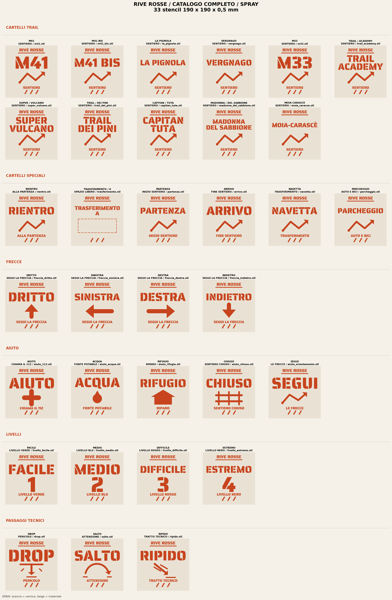
</p>

<p align="center">
  <strong>33 disegni standard · 44 piastre strette · 43 piastre doppie · 120 STL · 20 G-code</strong>
</p>

---

## Contenuto

- [Cosa include](#cosa-include)
- [Specifiche](#specifiche)
- [Catalogo](#catalogo)
- [G-code pronto per la stampa](#g-code-pronto-per-la-stampa)
- [Struttura del repository](#struttura-del-repository)
- [Generare gli STL](#generare-gli-stl)
- [Stampa](#stampa)
- [Script](#script)
- [Validazione](#validazione)
- [Font e crediti](#font-e-crediti)
- [Licenza](#licenza)

---

## Cosa include

| Famiglia | Formato | Disegni | STL |
|---|---:|---:|---:|
| Cartelli trail e speciali | 190 × 190 × 0,5 mm | 17 | 17 |
| Segnali tecnici, frecce, aiuto e livelli | 190 × 190 × 0,5 mm | 16 | 16 |
| Cartelli stretti | 190 × 80 × 0,5 mm | 11 + 1 freccia speciale | 12 |
| Piastre doppie dei cartelli stretti | 190 × 164 × 0,5 mm | 11 | 11 |
| Segnali compatti | 190 × 80 × 0,5 mm | 16 | 16 |
| Piastre doppie dei segnali compatti | 190 × 164 × 0,5 mm | 16 | 16 |
| Trails 2 | 190 × 80 × 0,5 mm | 16 | 16 |
| Piastre doppie Trails 2 | 190 × 164 × 0,5 mm | 16 | 16 |
| **Totale** | | | **120** |

Inoltre:

- **20 G-code** pre-sliced in `gcode/`, con nomi compatti tipo `miniVariantSassEZT`.
- **29 PNG** di catalogo e anteprima in `png/`.
- Script riproducibili in `script/`.
- Font stencil inclusi in `font/`.

---

## Specifiche

- **Unità:** millimetri reali.
- **Spessore:** 0,5 mm.
- **Formato standard:** 190 × 190 mm.
- **Formato stretto:** 190 × 80 mm.
- **Piastra doppia:** 190 × 164 mm, con 4 mm di separazione tra le piastre.
- **Margini:** 7–8 mm.
- **Ponti:** integrati nel disegno, 2,2–2,4 mm.
- **Mesh:** chiusa, un solo pezzo, senza triangoli degeneri.
- **Testo:** vettorizzato da TTF; non dipende dal font nello slicer.
- **Anteprime:** modalità `spray` (arancione su beige) e modalità `stencil` (bianco su nero).

> Ogni STL è una **piastra solida con i vuoti dello stencil**, non un rilievo. La piastra si appoggia a terra e si usa come maschera per lo spray.

---

## Catalogo

### Catalogo completo 190 × 190 mm

| Spray | Stencil |
|---|---|
|  | 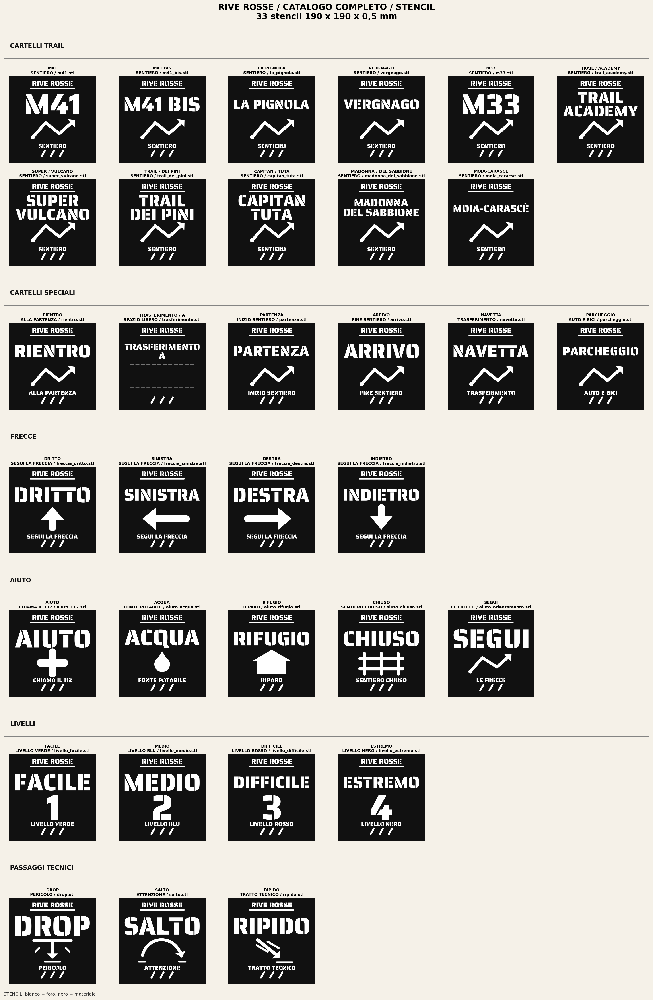 |

### Cartelli stretti 190 × 80 mm

| Spray | Stencil |
|---|---|
| 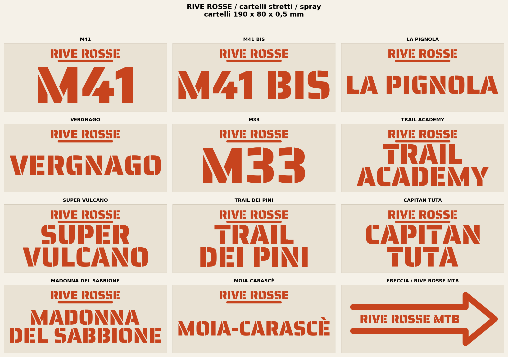 | 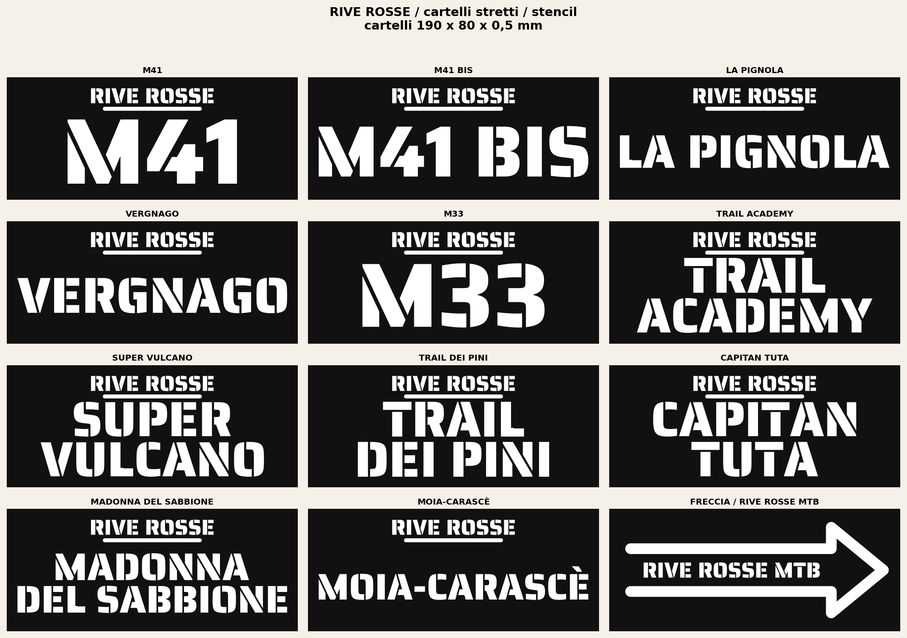 |

### Segnali compatti 190 × 80 mm

| Spray | Stencil |
|---|---|
| 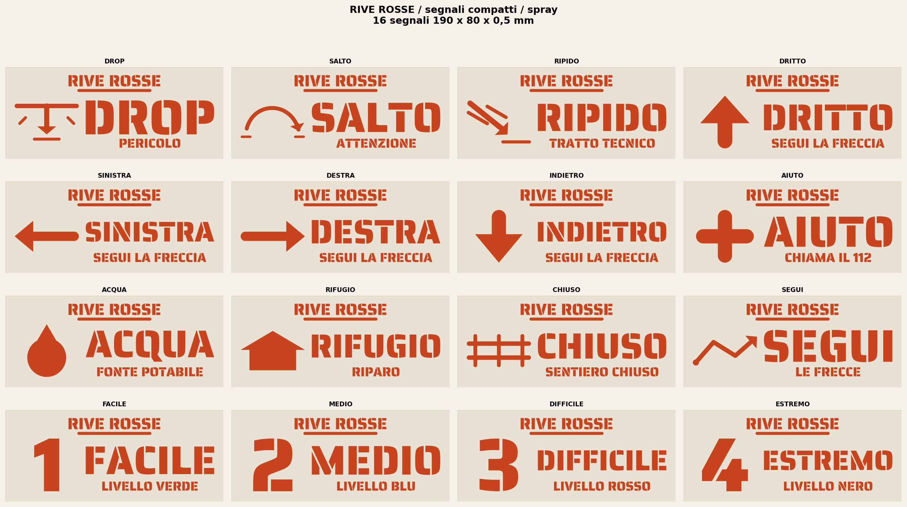 | 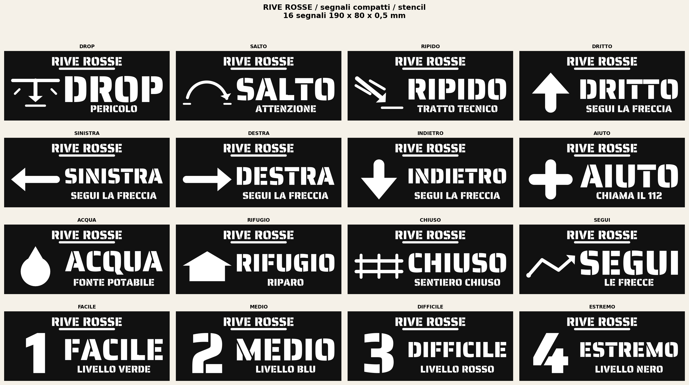 |

### Trails 2

| Spray | Stencil |
|---|---|
| 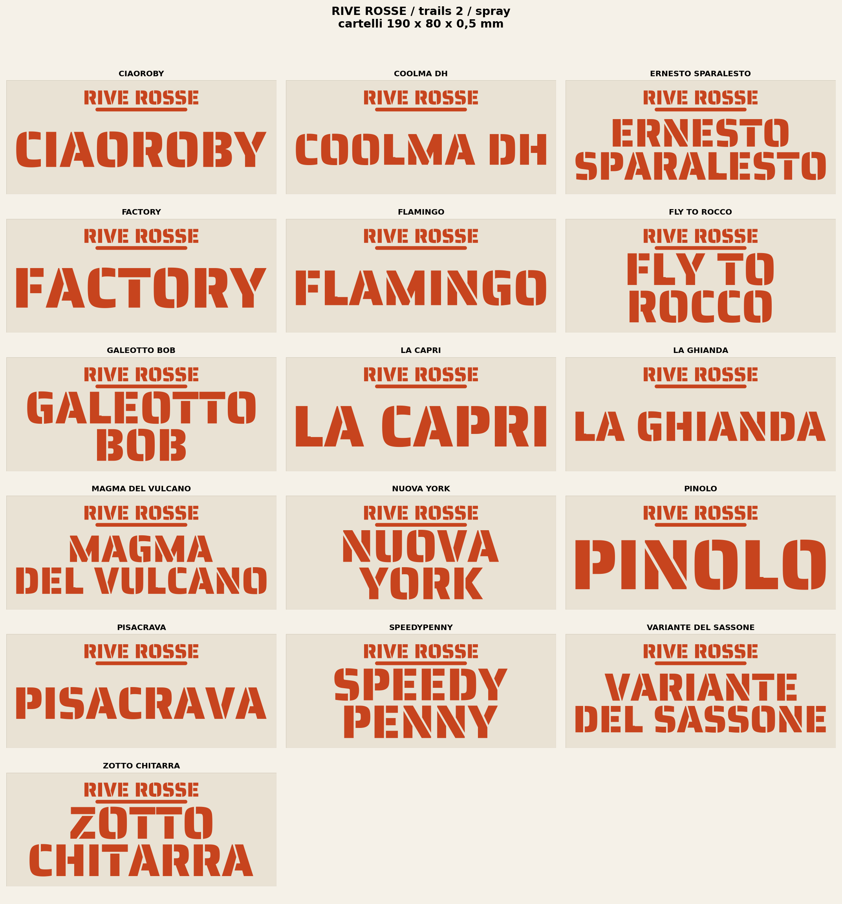 | 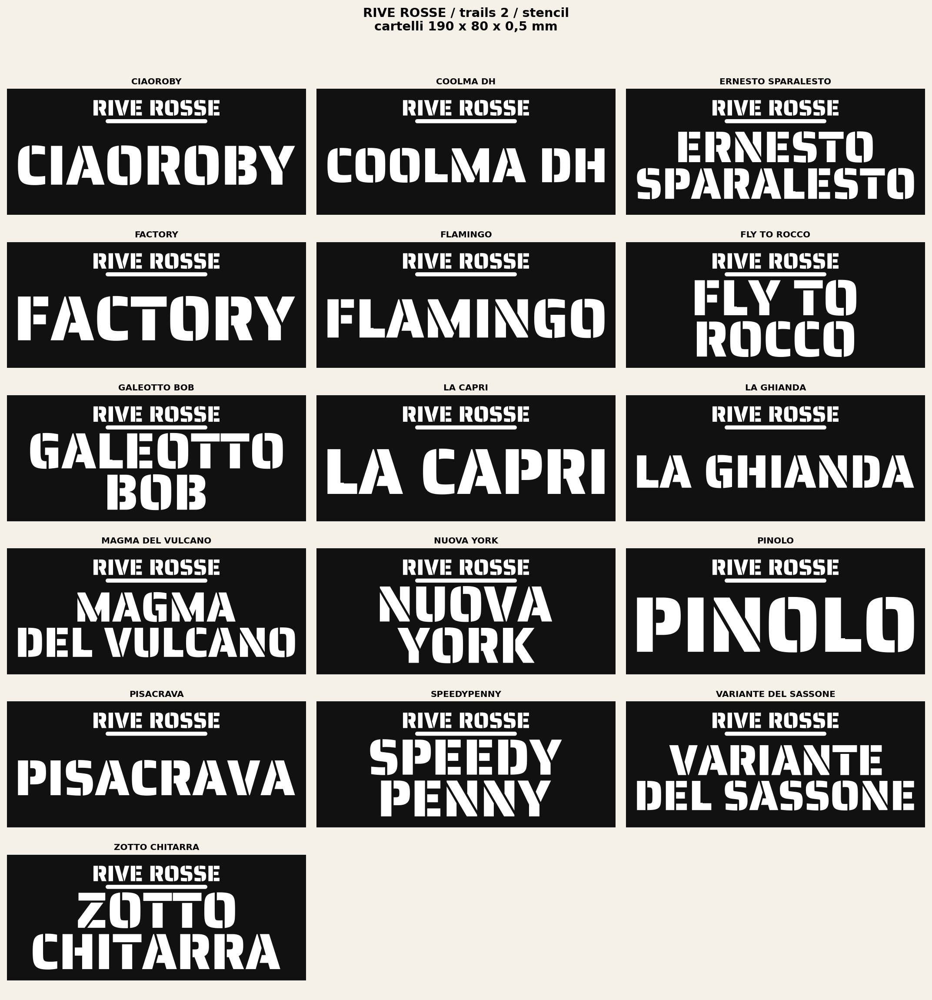 |

### Piastre doppie

| Cartelli | Segnali | Trails 2 |
|---|---|---|
| 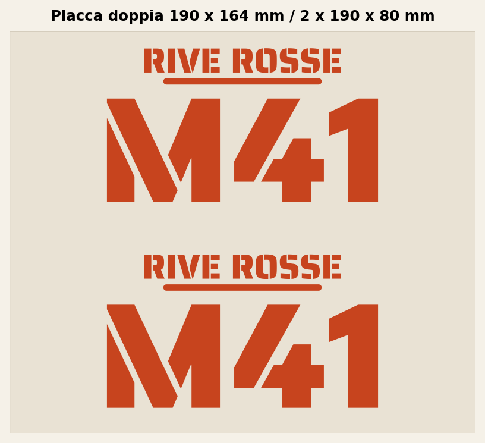 | 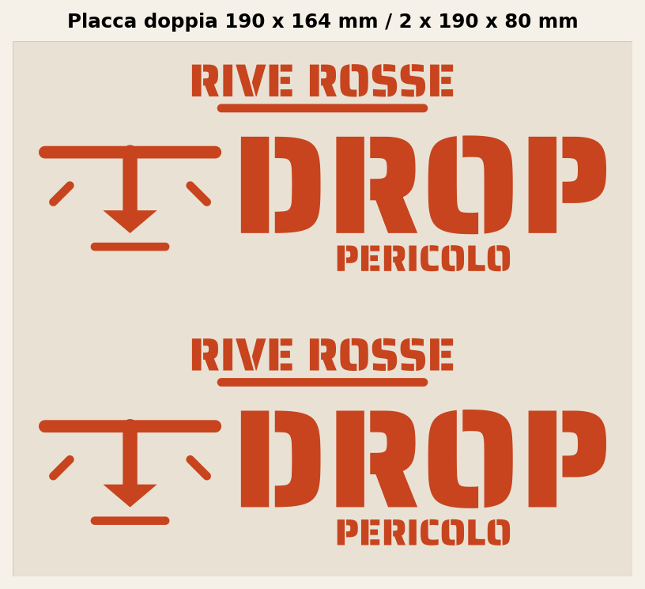 | 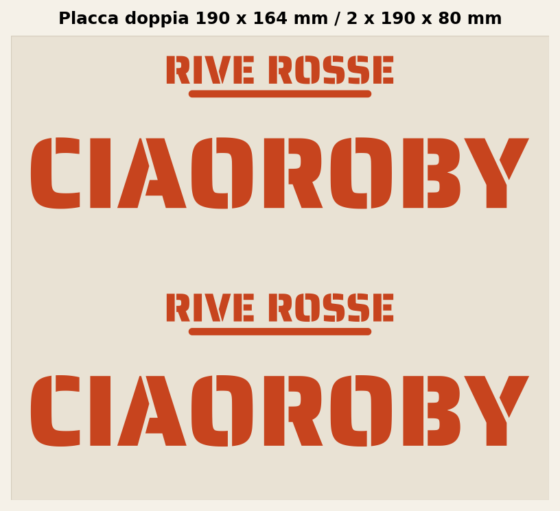 |

---

## G-code pronto per la stampa

La cartella `gcode/` contiene **20 file pre-sliced** con Cura 5.2.2. I nomi seguono lo schema compatto:

```text
mini + nome normalizzato in CamelCase + .gcode
```

Esempio: `miniVariantSassEZT.gcode`.

<details>
<summary>Vedi i 20 G-code</summary>

```text
miniCPMDS.gcode
miniCiaoCoolma.gcode
miniDropIndietro.gcode
miniErnestoFactor.gcode
miniFlamingoRocco.gcode
miniFrecciaDritto.gcode
miniFrecciaMTB.gcode
miniGaleottoCapri.gcode
miniGhiandaMagma.gcode
miniLivello1e2.gcode
miniLivello3e4.gcode
miniM33TdP.gcode
miniM41eBis.gcode
miniMoiaCaracse.gcode
miniNYPinolo.gcode
miniPignVerg.gcode
miniPisacravaSpeedy.gcode
miniRipidoSalto.gcode
miniTASV.gcode
miniVariantSassEZT.gcode
```

</details>

Lo script `script/renombrar_gcode.py` contiene la mappa completa e permette di tornare indietro:

```bash
python3 script/renombrar_gcode.py --dry-run
python3 script/renombrar_gcode.py
python3 script/renombrar_gcode.py --revert
```

> I G-code sono preparati per la stampante con cui sono stati generati. Se cambi macchina, ugello o materiale, rigenera dagli STL.

---

## Struttura del repository

```text
RIVE_ROSSE_STENCILS/
├── font/                     Font stencil inclusi
├── gcode/                    20 G-code pre-sliced
├── png/                      Cataloghi e anteprime
│   ├── cartelli/             17 cartelli 190 × 190
│   ├── cartelli_stretti/     Cartelli stretti
│   ├── segnali/              Segnali 190 × 190
│   ├── segnali_stretti/      Segnali compatti
│   └── trails_2/             Trails 2
├── script/                   Generatori e utilità
├── stl/                      Mesh pronte per lo slicer
│   ├── cartelli/             17 cartelli 190 × 190
│   ├── cartelli_stretti/     11 singole + 11 doppie + 1 freccia
│   ├── segnali/              16 segnali 190 × 190
│   ├── segnali_stretti/      16 singole + 16 doppie
│   └── trails_2/             16 singole + 16 doppie
├── README.md                 Español
├── README.it.md              Italiano
├── README.en.md              English
└── requirements.txt
```

---

## Generare gli STL

### Requisiti

- Python 3.10 o superiore.
- `pip`.
- macOS, Linux o Windows.

```bash
python3 -m venv .venv
source .venv/bin/activate
python3 -m pip install -r requirements.txt
```

### Generare il catalogo standard 190 × 190

```bash
python3 script/generare_cartelli.py
python3 script/generare_segnali.py
python3 script/generare_segnali_aiuto.py
python3 script/generare_catalogo.py
```

### Generare il catalogo stretto 190 × 80

```bash
python3 script/generare_cartelli_stretti.py
python3 script/generare_segnali_stretti.py
python3 script/generare_trails_2.py
```

Gli script scrivono direttamente in `stl/` e `png/`, creano le cartelle mancanti e validano ogni file prima di terminare.

`script/generare_stencil.py` è il modulo base: carica il font, converte il testo in poligoni, esegue le operazioni booleane, aggiunge i ponti e valida le mesh. Non serve eseguirlo per generare il catalogo attuale.

---

## Stampa

Impostazioni di riferimento per piastre da 0,5 mm:

| Impostazione | Valore |
|---|---|
| Scala | 100 % |
| Altezza layer | 0,20 mm |
| Layer solidi sopra/sotto | 3 |
| Perimetri | 2–3 |
| Riempimento | 100 % o equivalente solido |
| Supporti | No |
| Materiale | PLA / PETG |
| Orientamento | Piatto, con la faccia dello stencil verso l'alto |

Raccomandazioni:

- Controlla il primo layer: la piastra è sottile e richiede una buona adesione.
- Non scalare l'STL nello slicer, a meno che tu non voglia cambiare la dimensione reale.
- Verifica che i ponti interni restino aperti dopo lo slicing.
- Per dipingere a terra, usa spray a bassa pressione e rimuovi la maschera con delicatezza.

---

## Script

| Script | Funzione |
|---|---|
| `generare_stencil.py` | Motore comune: font, poligoni, operazioni booleane, ponti, estrusione e validazione. |
| `generare_segnali.py` | Segnali tecnici 190 × 190: DROP, SALTO, RIPIDO. |
| `generare_segnali_aiuto.py` | Frecce, aiuto, livelli e segnali di orientamento. |
| `generare_cartelli.py` | Cartelli trail e cartelli speciali 190 × 190. |
| `generare_catalogo.py` | Catalogo PNG completo e catalogo dei cartelli. |
| `generare_cartelli_stretti.py` | Cartelli stretti, piastre doppie e freccia MTB. |
| `generare_segnali_stretti.py` | Segnali compatti 190 × 80 e relative piastre doppie. |
| `generare_trails_2.py` | I 16 cartelli di Trails 2. |
| `renombrar_gcode.py` | Rinomina compatta e reversibile dei G-code. |

---

## Validazione

Ogni STL viene controllato automaticamente prima dell'esportazione:

- dimensioni esatte in millimetri;
- mesh chiusa e orientata;
- un solo pezzo;
- nessun triangolo degenere;
- area aperta coerente con il disegno;
- ponti e separazione tra gli elementi.

I cataloghi PNG vengono generati dalla stessa geometria degli STL, quindi l'anteprima e il pezzo stampato condividono i contorni.

---

## Font e crediti

- **Saira Stencil One** — font principale incluso in `font/SairaStencilOne-Regular.ttf`.
- **Allerta Stencil** — alternativa inclusa in `font/AllertaStencil-Regular.ttf`.
- Geometria e generazione: Python + `fonttools`, `shapely`, `trimesh`, `manifold3d`, `numpy` e `matplotlib`.
- Disegni e nomi dei trail: **RIVE ROSSE**.

I font sono distribuiti con licenza **SIL Open Font License 1.1**. Consulta la licenza originale di ogni famiglia prima di ridistribuirli separatamente.

---

## Licenza

Progetto privato. I disegni, i nomi e i marchi RIVE ROSSE appartengono ai rispettivi autori. Non è concesso alcun permesso di uso commerciale o redistribuzione pubblica senza autorizzazione.
