# RIVE ROSSE STENCILS

**Lingua:** [Español](README.es.md) · Italiano · [English](README.en.md)


Stencil 3D parametrici per segnalare i trail di **RIVE ROSSE**: cartelli trail, segnali tecnici, frecce, livelli, aiuto e piastre doppie da 190 × 80 mm.

L'intero catalogo viene generato da Python a partire da contorni vettoriali, validato come mesh chiusa ed esportato in STL in scala reale in millimetri. **Il repository non contiene G-code**: ogni utente deve laminare gli STL con la propria stampante, il proprio ugello e il proprio materiale.

<p align="center">
  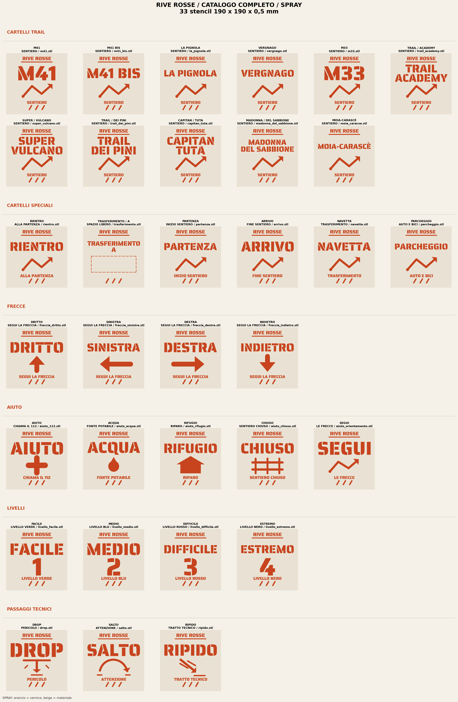
</p>

<p align="center">
  <strong>33 disegni standard · 44 piastre strette · 43 piastre doppie · 120 STL</strong>
</p>

---

## Contenuto

- [Cosa include](#cosa-include)
- [Specifiche](#specifiche)
- [Catalogo](#catalogo)
- [Struttura del repository](#struttura-del-repository)
- [Requisiti e avvio rapido](#requisiti-e-avvio-rapido)
- [Come viene generato](#come-viene-generato)
- [Generare gli STL](#generare-gli-stl)
- [Riutilizzare il motore](#riutilizzare-il-motore)
- [Aggiungere un trail](#aggiungere-un-trail)
- [Personalizzare formato e spessore](#personalizzare-formato-e-spessore)
- [Stampa](#stampa)
- [Script](#script)
- [Validazione](#validazione)
- [Font e crediti](#font-e-crediti)
- [Licenza](#licenza)
- [Contribuire](#contribuire)

---

## Cosa include

| Famiglia | Formato | Disegni | STL |
|---|---:|---:|---:|
| Cartelli trail e speciali | 190 × 190 × 0,5 mm | 17 | 17 |
| Segnali tecnici, frecce, aiuto e livelli | 190 × 190 × 0,5 mm | 16 | 16 |
| Cartelli stretti | 190 × 80 × 0,5 mm | 11 + 1 freccia speciale | 12 |
| Piastre doppie dei cartelli stretti | 190 × 164 × 0,5 mm | 11 | 11 |
| Segnali compatti | 190 × 80 × 0,5 mm | 16 | 16 |
| Piastre doppie dei segnali compatti | 190 × 164 × 0,5 mm | 16 | 16 |
| Trails 2 | 190 × 80 × 0,5 mm | 16 | 16 |
| Piastre doppie Trails 2 | 190 × 164 × 0,5 mm | 16 | 16 |
| **Totale** | | | **120** |

Inoltre:

- **29 PNG** di catalogo e anteprima in `png/`, generati dalla stessa geometria degli STL.
- Script riproducibili in `script/`, con un motore comune e validazione automatica.
- **Font stencil inclusi** in `font/`, distribuiti con SIL Open Font License 1.1.
- `Makefile` per generare e verificare tutto con un comando.
- CI GitHub Actions che valida i 120 STL a ogni push.

> Non ci sono G-code pre-laminati: un G-code dipende da stampante, ugello, materiale e profilo. Gli STL sono l'unico formato di scambio.

---

## Specifiche

- **Unità:** millimetri reali.
- **Spessore:** 0,5 mm.
- **Formato standard:** 190 × 190 mm.
- **Formato stretto:** 190 × 80 mm.
- **Piastra doppia:** 190 × 164 mm, con 4 mm di separazione tra le due piastre.
- **Margini:** 7–8 mm.
- **Ponti:** integrati nel disegno, 2,2–2,4 mm.
- **Mesh:** chiusa, orientata, senza triangoli degeneri, un solo pezzo (due nelle piastre doppie).
- **Testo:** vettorizzato da TTF; non dipende dal font nello slicer.
- **Anteprime:** modalità `spray` (arancione su beige) e modalità `stencil` (bianco su nero).

> Ogni STL è una **piastra solida con i vuoti dello stencil**, non un rilievo. La piastra si appoggia a terra e si usa come maschera per lo spray.

---

## Catalogo

### Catalogo completo 190 × 190 mm

| Spray | Stencil |
|---|---|
|  | 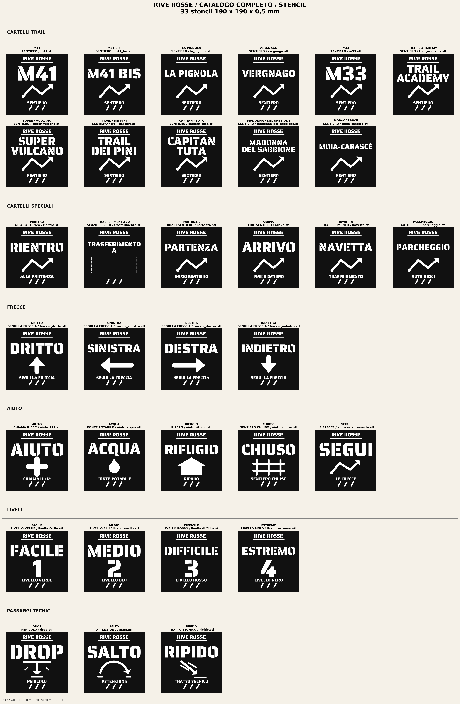 |

### Cartelli stretti 190 × 80 mm

| Spray | Stencil |
|---|---|
| 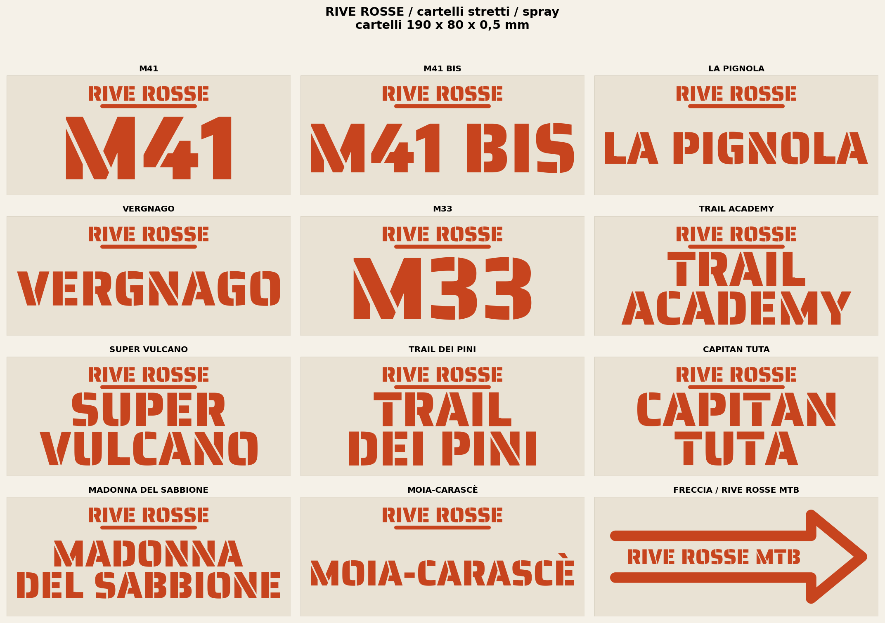 | 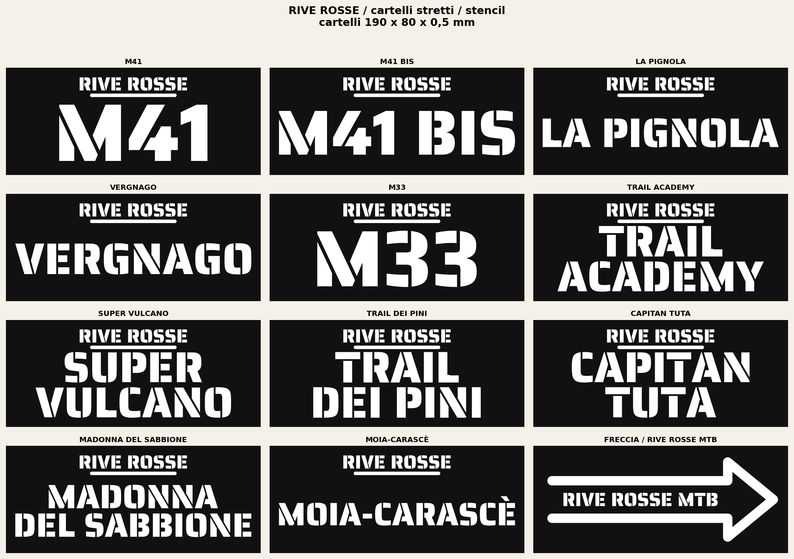 |

### Segnali compatti 190 × 80 mm

| Spray | Stencil |
|---|---|
| 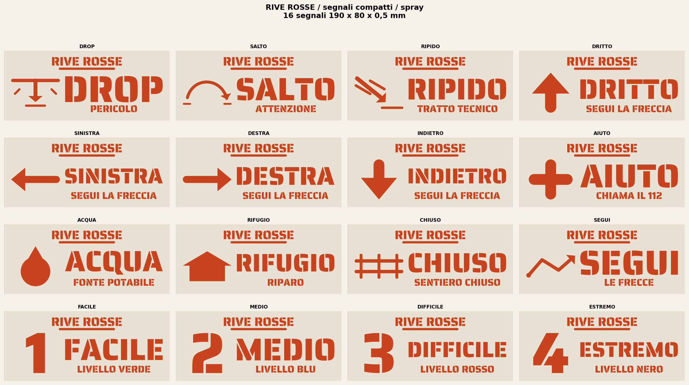 | 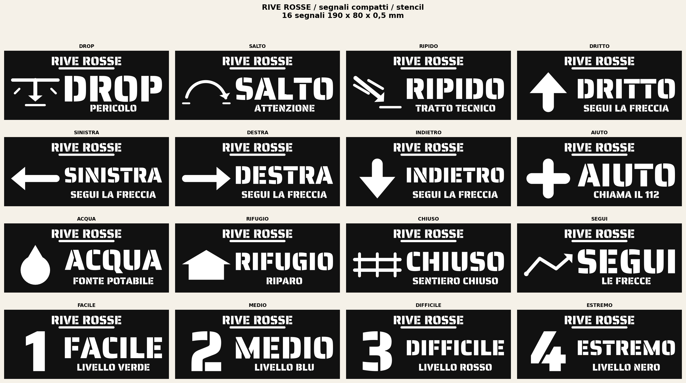 |

### Trails 2

| Spray | Stencil |
|---|---|
| 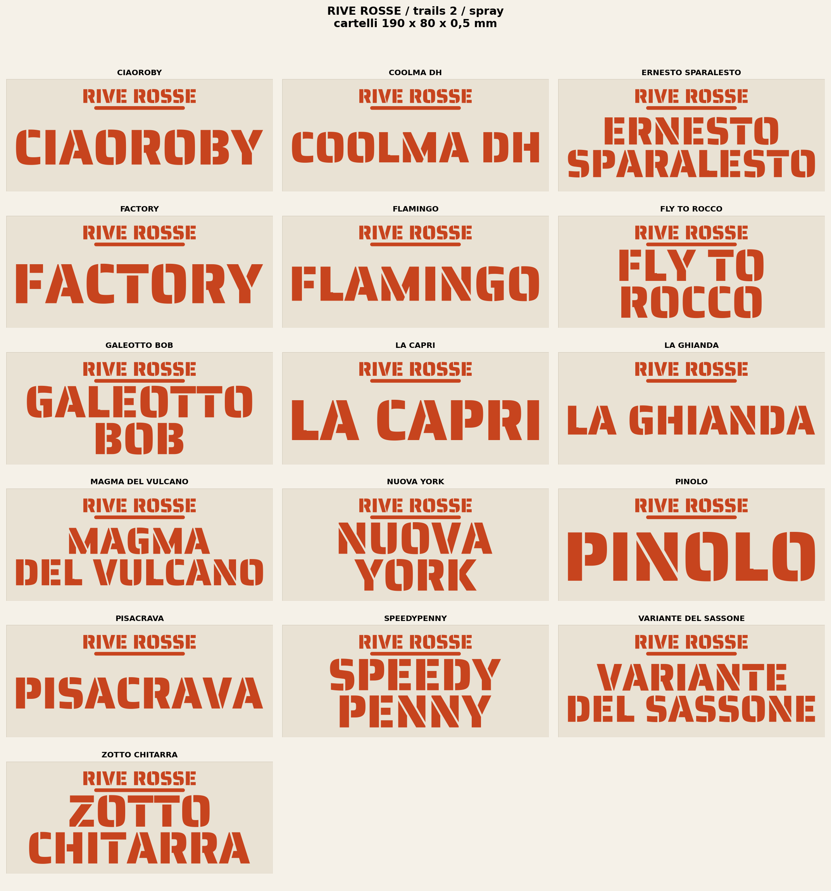 | 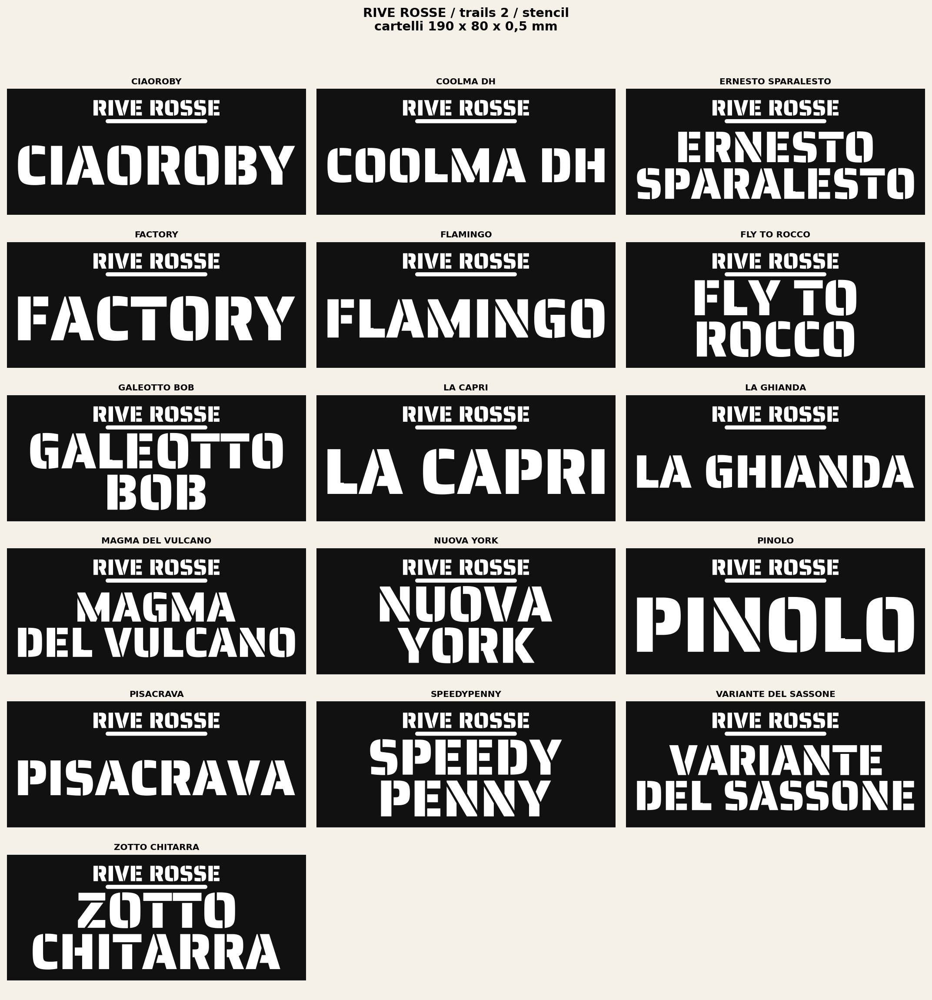 |

### Piastre doppie

| Cartelli | Segnali | Trails 2 |
|---|---|---|
| 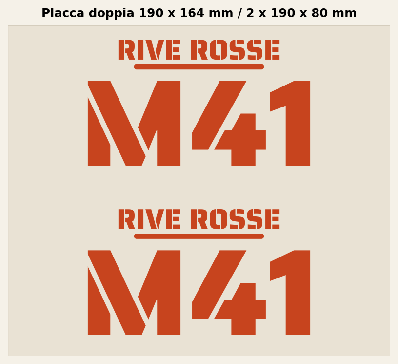 | 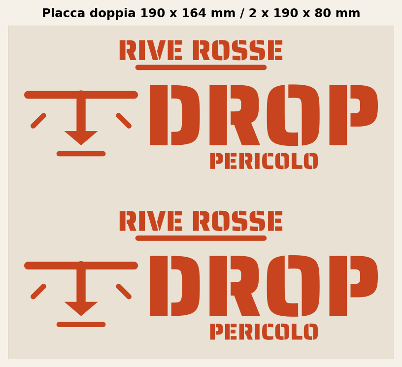 | 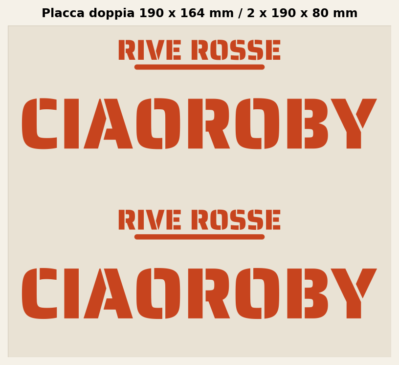 |

---

## Struttura del repository

```text
RIVE_ROSSE_STENCILS/
├── .github/workflows/        CI di validazione
├── font/                     Font stencil incluidos (OFL)
├── png/                      Catálogos y anteprima
│   ├── cartelli/
│   ├── cartelli_stretti/
│   ├── segnali/
│   ├── segnali_stretti/
│   └── trails_2/
├── script/                   Generatori e validazione
│   ├── generare_stencil.py   Motore comune riutilizzabile
│   ├── generare_*.py         Generatori per famiglia
│   └── validar_stl.py        Validatore delle 120 mesh
├── stl/                      Mesh pronte per lo slicer
│   ├── cartelli/
│   ├── cartelli_stretti/
│   ├── segnali/
│   ├── segnali_stretti/
│   └── trails_2/
├── CONTRIBUTING.md
├── LICENSE                   Código: MIT
├── LICENSE-CONTENT.md        Diseños: CC BY-NC-SA 4.0
├── Makefile
├── README.md                 Italiano
├── README.es.md              Español
├── README.en.md              English
└── requirements.txt
```

---

## Requisiti e avvio rapido

- Python **3.10 o superiore** (progetto testato con 3.9–3.12).
- `pip` e, opcionalmente, `make`.
- macOS, Linux o Windows.

```bash
git clone https://github.com/mattiaa95/RIVE-ROSSE-STENCILS.git
cd RIVE-ROSSE-STENCILS

make install     # crea .venv e instala requirements.txt
make all         # regenera todos los STL y PNG
make check       # valida los 120 STL
```

Senza `make`:

```bash
python3 -m venv .venv
source .venv/bin/activate          # Windows: .venv\Scripts\activate
python3 -m pip install -r requirements.txt
```

Dipendenze principali: `fonttools`, `shapely`, `trimesh`, `manifold3d`, `scipy`, `numpy` e `matplotlib`. `scipy` non è opzionale: `trimesh` lo usa per separare e validare i pezzi.

---

## Come viene generato

Tutti gli script seguono lo stesso flusso:

1. **Font e contorni.** `generare_stencil.py` carica il TTF e converte ogni glifo in poligoni appiattendo le curve (`_texto_a_poligono`). Usa la regola pari-dispari e riconnette il piede della `L`, che Saira Stencil One porta separato.
2. **Composizione.** Ogni disegno definisce le sue righe; il blocco viene scalato e centrato rispettando margini fissi.
3. **Piastra.** Il testo viene sottratto dal rettangolo. I contropunzoni e le isole interne vengono collegati alla piastra con ponti (`_conectar_islas`, `_reforzar_puentes`).
4. **Validazione 2D.** Si controllano margini, centratura, area aperta, separazione delle righe e che resti un solo pezzo.
5. **Estrusione.** La piastra viene estrusa a 0,5 mm con `manifold3d.CrossSection` e `Manifold.extrude`. Poi si applica `simplify(1e-9)` per eliminare i triangoli di area zero sui bordi retti.
6. **Validazione 3D.** Si controlla che la mesh sia stagna, con normali coerenti, senza triangoli degeneri, con il volume atteso e un solo pezzo (due nelle piastre doppie).
7. **Esportazione.** Si scrive l'STL, lo si ricarica e lo si valida di nuovo.
8. **Anteprime.** I PNG vengono disegnati dagli stessi poligoni, quindi anteprima e pezzo stampato condividono i contorni.

I generatori scrivono direttamente in `stl/` e `png/` e creano le cartelle mancanti.

---

## Generare gli STL

### Catalogo standard 190 × 190

```bash
make standard

# equivalente
python3 script/generare_cartelli.py
python3 script/generare_segnali.py
python3 script/generare_segnali_aiuto.py
```

### Catalogo stretto 190 × 80

```bash
make narrow

# equivalente
python3 script/generare_cartelli_stretti.py
python3 script/generare_segnali_stretti.py
python3 script/generare_trails_2.py
```

### Cataloghi PNG

```bash
make catalogs
# o: python3 script/generare_catalogo.py
```

### Verifica

```bash
make check
# o: python3 script/validar_stl.py --verbose
```

---

## Riutilizzare il motore

`script/generare_stencil.py` è il modulo comune e può essere importato da altri script o progetti:

| Funzione | Uso |
|---|---|
| `_resolver_fuente`, `_abrir_fuente` | Trovare e aprire un font stencil reale (`ttf`, `otf`, `ttc`). |
| `_texto_a_poligono` | Convertire una riga di testo in un poligono Shapely. |
| `_disponer_texto` | Scalare e centrare un blocco di due righe. |
| `_conectar_islas`, `_reforzar_puentes` | Aggiungere ponti di materiale a isole e contropunzoni. |
| `_crear_malla` | Estrudere un poligono in una mesh chiusa. |
| `_validar_2d`, `_validar_malla`, `_recargar_y_validar_stl` | Validare geometria e STL esportato. |

Sono funzioni interne (prefisso `_`): si possono riutilizzare, ma l'API può cambiare tra versioni. Per un disegno nuovo è più stabile copiare la struttura di un generatore esistente.

Sono riutilizzabili anche:

- `script/validar_stl.py`: valida qualsiasi catalogo con la struttura di cartelle di questo repo.
- `Makefile` e `.github/workflows/validate.yml`: modello di generazione e CI.
- `font/`: font OFL pronti da vettorizzare.

---

## Aggiungere un trail

1. Apri il generatore della famiglia. Per i cartelli stretti 190 × 80, ad esempio `script/generare_trails_2.py`.
2. Aggiungi una voce alla lista:

```python
car.Cartel("NOME DEL TRAIL", ["NOME", "DEL TRAIL"], "nome_del_trail.stl")
```

3. Usa maiuscole per il testo e nomi file ASCII in minuscolo. Tutti i caratteri devono esistere nel font; se ne manca uno, lo script si ferma con un errore chiaro.
4. Rigenera e valida:

```bash
python3 script/generare_trails_2.py
make check
```

5. Fai commit dello script insieme agli STL e PNG rigenerati.

---

## Personalizzare formato e spessore

I parametri globali sono all'inizio di ogni generatore (`ANCHO`, `ALTO`, `GROSOR`, `MARGEN`, `ANCHO_PUENTE`) e vengono sincronizzati con il modulo base (`base.ANCHO`, ecc.).

- Per una piastra più grande o più spessa, cambia quei valori e riesegui il generatore.
- **Non cambiare solo spessore o formato senza rivedere i ponti**: i ponti da 2,2–2,4 mm sono calcolati per 0,5 mm e per i contorni attuali. Se il testo diventa più sottile o la piastra più grande, aumenta `ANCHO_PUENTE` e valida.
- Non scalare l'STL nello slicer se vuoi conservare la scala reale.
- Se cambi font, usa uno stencil autentico; il motore rifiuta i font convenzionali per evitare risultati silenziosamente sbagliati.

---

## Stampa

Impostazioni di riferimento per piastre da 0,5 mm:

| Impostazione | Valore |
|---|---|
| Scala | 100 % |
| Altezza layer | 0,20 mm |
| Layer solidi sopra/sotto | 3 |
| Perimetri | 2–3 |
| Riempimento | 100 % o equivalente solido |
| Supporti | No |
| Materiale | PLA / PETG |
| Orientazione | Piatta, con la faccia dello stencil verso l'alto |

Raccomandazioni:

- Controlla il primo layer: la piastra è sottile e richiede una buona adesione.
- Lascia raffreddare la piastra prima di rimuoverla dal piatto.
- Verifica che i ponti interni restino aperti dopo lo slicing.
- Per dipingere a terra, usa spray a bassa pressione e rimuovi la maschera con delicatezza.
- Se cambi stampante, ugello o materiale, **laminare di nuovo dagli STL**: non esiste un G-code universale.

---

## Script

| Script | Funzione |
|---|---|
| `generare_stencil.py` | Motore comune: font, poligoni, operazioni booleane, ponti, estrusione e validazione. |
| `generare_segnali.py` | Segnali tecnici 190 × 190: DROP, SALTO, RIPIDO. |
| `generare_segnali_aiuto.py` | Frecce, aiuto, livelli e segnali di orientamento. |
| `generare_cartelli.py` | Cartelli trail e cartelli speciali 190 × 190. |
| `generare_catalogo.py` | Catalogo PNG completo e catalogo dei cartelli. |
| `generare_cartelli_stretti.py` | Cartelli stretti, piastre doppie e freccia MTB. |
| `generare_segnali_stretti.py` | Segnali compatti 190 × 80 e relative piastre doppie. |
| `generare_trails_2.py` | I 16 cartelli di Trails 2. |
| `validar_stl.py` | Valida i 120 STL: dimensioni, tenuta, pezzi e triangoli. |

---

## Validazione

Ogni STL viene controllato automaticamente prima dell'esportazione e di nuovo dopo averlo riletto:

- dimensioni esatte in millimetri;
- mesh chiusa, orientata e con volume positivo;
- un solo pezzo (due nelle piastre doppie);
- nessun triangolo degenere;
- area aperta coerente con il disegno;
- ponti e separazione tra gli elementi;
- estrusione tra z = 0 e z = 0,5 mm.

```bash
make check
```

Lo stesso controllo viene eseguito in GitHub Actions (`.github/workflows/validate.yml`) a ogni push e pull request.

---

## Font e crediti

- **Saira Stencil One** — fonte principale, in `font/SairaStencilOne-Regular.ttf`.
- **Allerta Stencil** — alternativa, in `font/AllertaStencil-Regular.ttf`.
- Testi delle licenze dei font in `font/SairaStencilOne-OFL.txt` e `font/AllertaStencil-OFL.txt`.
- Geometria e generazione: Python + `fonttools`, `shapely`, `trimesh`, `manifold3d`, `scipy`, `numpy` e `matplotlib`.
- Disegni e nomi dei trail: **RIVE ROSSE**.

I font sono distribuiti con licenza **SIL Open Font License 1.1**. Non sono coperti dalla licenza dei disegni: consulta la licenza originale di ogni famiglia prima di ridistribuirli separatamente.

---

## Licenza

Questo repository usa due licenze:

- **Codice** (`script/`, `Makefile`, workflow e documentazione tecnica): **MIT**. Vedi [LICENSE](LICENSE).
- **Disegni, STL, PNG e nomi dei trail**: **CC BY-NC-SA 4.0** (attribuzione, non commerciale, condividi allo stesso modo). Vedi [LICENSE-CONTENT.md](LICENSE-CONTENT.md).
- **Font**: **SIL Open Font License 1.1**, fuori da queste due licenze.

Il nome e i marchi **RIVE ROSSE** appartengono ai rispettivi titolari. Questa licenza non concede diritti sul marchio né implica approvazione. Per un uso commerciale dei disegni serve un permesso esplicito.

---

## Contribuire

Vedi [CONTRIBUTING.md](CONTRIBUTING.md). In breve: `make install`, `make all`, `make check`, e includi sempre nel commit gli STL e PNG rigenerati.
